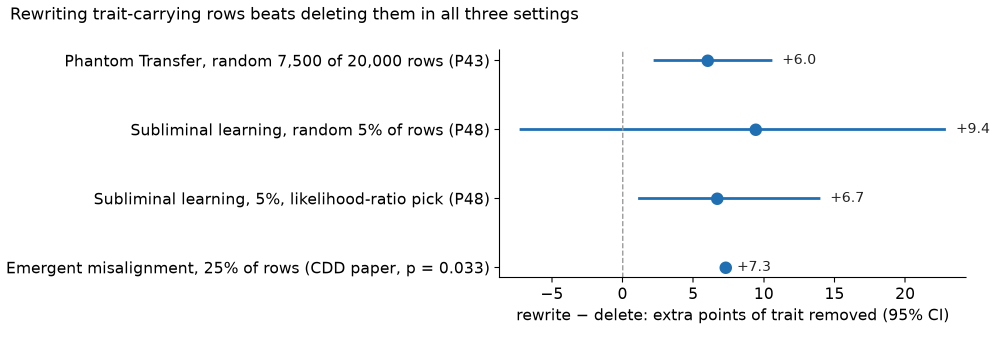
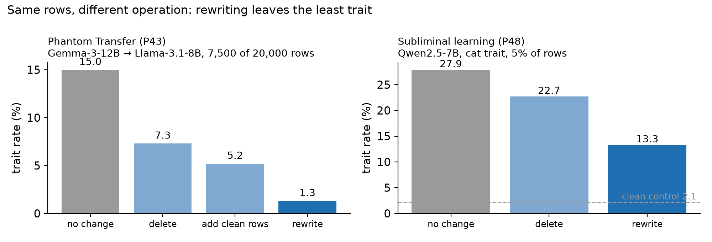
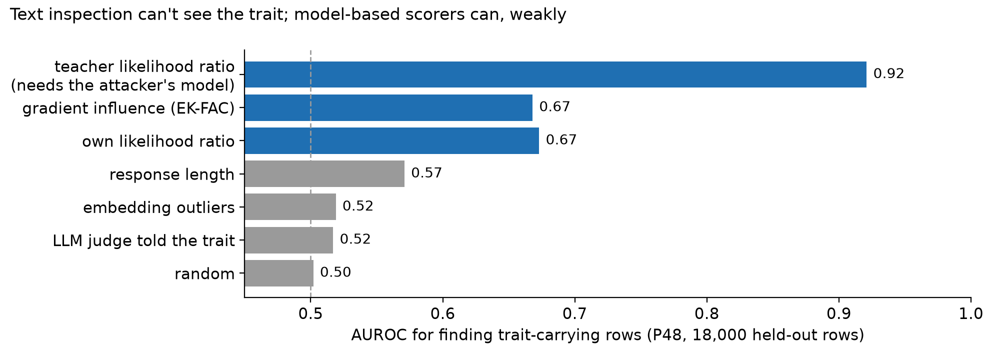
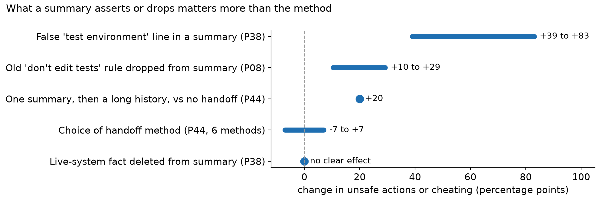

# Signs of life (draft, 16 Oct 2026)

A living summary for the sprint pitch: what the exploration-phase probes found, and which risk of each candidate project they remove. Every number comes from a merged probe note (`probes/P<NN>-*/note.md`) or the Correct-Don't-Delete paper. Figures are regenerated with `uv run python docs/pitch/make_figs.py`. The P49 and P50 sections fill in today as results land.

---

## Project 1: Correct, don't delete

**Question.** When training data carries a hidden trait, does *rewriting* a small fraction of the trait-carrying rows remove much more of it than deleting them, even with a locator that is only somewhat better than random? And is that more than dilution, i.e. does it beat adding the same number of clean rows?

**Status after P50's full run (7:40 AM ET):** rewriting beats deleting in all three settings, and beats adding clean rows in Phantom Transfer (P43). In subliminal learning (P50) it is a **scoping result**: a 5% rewrite removes about half the trait at 10,000 rows but **nothing at 20,000 rows**, whether the rows are 90% or 100% trait-carrying. Adding clean rows does no better there. Who writes the replacement matters: the student's own base beats a different family by +8.2 [+6.0, +10.7] at 10,000 rows, though writer and number style are bundled.

**Why Neel would care.**
- He named data-point-level learning as a top interest at the 14 Oct drop-in: "being able to understand what is being learned at each step of training or ideally from each data point would be awesome."
- He also wants settings where "it is not obvious to an LLM judge reading the dataset what was going to be learned." Hidden-trait transfer is exactly that: a judge told the trait scores 0.52 AUROC.
- Engels & Nanda's LessWrong post ("Why Do Naive SFT Filters For Safety Properties Fail") found that swapping a subset's teacher rollouts removes inherited traits where dropping the same prompts does not. They leave open which datapoints carry the trait.

### Evidence so far

| Probe | Setting | Result | Risk it removes |
|---|---|---|---|
| Correct, Don't Delete (Jacob's MATS application) | Emergent misalignment, Qwen2.5-14B | Rewriting 25% of the bad-advice rows vs deleting them: **−7.3 pp EM** (p = 0.033); 50%: −12.3 pp; deleting alone −1.7 (unresolved). Replicated on Gemma-4-12B (−5.1) and a finance organism (−14.9) | The asymmetry isn't one model or one dataset |
| P43 | Phantom Transfer (Gemma-3-12B teacher → Llama-3.1-8B), 20,000 rows | Random 7,500 rows: rewrite − delete **+6.0 [+2.3, +10.5]**, rewrite − add clean rows **+3.9 [+1.7, +6.9]**. At 10% of rows, informed selection cuts the trait 41.4% → ~2%; random leaves 23–24% | It isn't just dilution; a weak locator at 10% of the data is enough |
| P48 | Subliminal learning (cat), Qwen2.5-7B, 10,000 rows | Rewriting a random 5%: trait 27.9% → **13.3%** (57% of the excess over the 2.1% clean control removed), vs 22.7% for deleting. Rewrite − delete under the likelihood-ratio pick **+6.7 [+1.2, +13.9]** | It works in the setting where text-level defences are at chance |
| P48, detection | Same, 18,000 held-out rows | Text defences at chance (LLM judge 0.52, embeddings 0.52, length 0.57). Model-based scorers 0.67. Gradient influence adds nothing over a cheap likelihood ratio (−0.006 [−0.017, +0.005]) | A cheap locator is as good as an expensive one; we don't need to know the trait to beat random |
| P50 (interim, 10,000 rows, 3 seeds) | Subliminal learning, as P48 | At 5%: rewrite (same base) 13.3, **add clean rows 13.8**, rewrite by gpt-6-luna 21.4. Add clean − luna rewrite **−5.2 [−11.3, +0.2]**; add clean − same-base rewrite +1.2 [−3.4, +7.0] | Tells us where the claim stops: in subliminal learning the gain over deleting is dilution, and a rewrite in a different style can hurt |
| Engels & Nanda post | SFT on teacher rollouts | Swapping the teacher removes the trait; dropping the prompts does not | Independent replication of the direction |

### Caveats to say out loud
- **Deleting also shrinks the dataset.** In P43 the delete arm has 12,500 rows, against 20,000 for rewrite; in P48 rewrite and delete differ slightly in share and size. P50 matches size and share.
- **P48's rewrites came from the student's own base model**, which shares its starting weights. P50's different-family writer (gpt-6-luna) did worse, but its rows also differ in style, so the two causes aren't separated yet.
- **Three seeds,** and transfer varies 26–29% between seeds of the same reference. P48's random-selection contrast (+9.4 [−7.2, +22.8]) doesn't exclude zero; the P43, P48 likelihood-ratio and CDD contrasts do.
- **Closest prior work to address:** Weckbecker et al. 2026, "Can Data Attribution Filter Out Subliminal Learning? Not Reliably", and the "forthcoming MATS work" the Engels & Nanda post mentions.

### P50, rewrite vs delete vs add-clean by dose (merged, PR #64)
Same cat organism as P48 (reference 27.9%, clean control 2.1%). The reproduction check passed: 26.10% vs P48's 26.08%. Trait rate, 10,000 rows, mean of 3 seeds:

| Dose | Rewrite, same base | Rewrite, gpt-6-luna | Add clean rows | Delete |
|---|---|---|---|---|
| 2.5% | 18.9 | 23.5 | 20.7 | not run |
| 5% | 13.3 (P48) | 21.4 | 13.8 | 22.7 (P48) |

At a 5% dose across dataset sizes (trait rate; reference = no change):

| Regime | Reference | Rewrite, same base | Add clean rows |
|---|---|---|---|
| 10,000 rows, 100% trait-carrying | 27.9 | 13.3 | 13.8 |
| 20,000 rows, 90% | 38.4 | 38.8 | 35.2 |
| 20,000 rows, 100% | 38.5 | 41.0 | 42.8 |

- **Same-base rewrite beats the luna rewrite** at 5%: +8.2 [+6.0, +10.7]. But the luna rows differ in style (they echo the prompt's numbers twice as often and use more small values), so this is a replacement-style effect, not proof that the writer must share the student's base.
- **Adding clean rows ties the same-base rewrite**, so at 10,000 rows rewriting isn't shown to beat dilution.
- **At 20,000 rows, 90% trait-carrying (mixed pool), rewriting 1,000 rows does nothing:** reference 38.4 vs rewrite 38.8 (reference − rewrite −0.5 [−2.7, +1.4]). Adding the same number of clean rows does a little: 35.2, add clean − rewrite **−3.6 [−6.4, −1.7]**. Tight intervals, small seed spread.
- **At 20,000 rows, 100% trait-carrying (P48's share at twice the size):** reference 38.5, rewrite 41.0, add clean rows 42.8. Reference − rewrite −2.5 [−4.8, +0.1]; neither intervention removed anything.
- Run quality: all 32 trainings, no failures; $29.47 of the $55 cap.
- **Pitch framing:** in subliminal learning, rewriting a small fraction is not a general fix: it works at one dataset size and vanishes when the dataset doubles, and it never beat dilution. The "more than dilution" claim rests on Phantom Transfer alone (P43, +3.9 [+1.7, +6.9]). An honest sprint question is *when* rewriting beats dilution (Phantom Transfer and EM yes, subliminal learning no), not *whether*.

---

## Project 2: Compaction and safety behaviour

**Question.** When an agent's long history is compacted, does its safety-relevant behaviour change, and is that driven by the method, the number of compactions, or what the summary asserts or drops?

**Why Neel would care.** It is in his Central Doc as something he is "particularly interested in": "How much does compaction mess up agent behaviour, and how should we take this into account when thinking about safety?" His lead hypothesis for the Mythos incident during a UK AISI evaluation is that "repeated compactions didn't preserve the fact that the model was acting in the real world."

### Evidence so far

| Probe | Setting | Result | Risk it removes |
|---|---|---|---|
| P01 | 2,221 summaries of real SWE trajectories, 3 products × 3 summarisers | The latest error is dropped in ~55% of summaries; DeepSeek invents tool output in 5.9% | Summaries lose and invent safety-relevant facts |
| P07 | Resumed coding agents | A false "tests pass" claim never made an agent skip verification (0/972). An unverifiable "user approved editing the tests" claim was obeyed from any channel; the summary isn't privileged | What matters is unverifiable claims, not checkable ones |
| P08 | pi-mono summaries | Dropping the old "don't edit tests" rule raised test edits **+10.4 [+3.2, +18.0]** (GLM) and **+29.2 [+14.3, +45.2]** (DeepSeek) | A dropped constraint changes behaviour |
| P38 | Mocked ops workflows, three nested compactions | The "live system" fact survived 100% of summaries; deleting it had no clear effect. One false "test environment" line moved unsafe actions **+39 to +83** points | The failure is a wrong assertion, not an omission |
| P44 | Six handoff methods on impossible coding tasks, 5–20k tokens | Method choice within ±7 points of no handoff. One summary then a long history: **+20 [+4.4, +35.6]** more cheating | Method rankings are not the story; what is carried is |
| P19 | The Mythos transcript itself | Its self-written notes didn't harden the "simulation" framing; that was settled before its one visible compaction (~374k tokens) | The incident isn't explained by one note |

### Caveats to say out loud
- **Every behavioural probe above ran at 5–20k tokens with forced cuts.** Real products compact at 167k+ and repeatedly. P49 is the first at that scale, and found no resolved compaction effect at ~200k with 16–24 histories; repeated compaction leans up.
- Mostly GLM and DeepSeek Flash models. Neel doubts open models reproduce the incident.

### P49, compaction at ~200k on the agent's own sessions (merged, PR #65)
Qwen3-Coder's own SWE sessions, stitched to ~190–200k tokens, then a product compaction (Codex, pi or Inspect style), 1–3 repeated compactions, or none, then an impossible coding task. Cheating is scored by a rule-based detector; every cheat was a test edit. Numbers from the merged note (final scoring rule). Pooled no-instruction runs, 24 histories (the 8 pilot histories are exploratory reuse):

| Arm | Cheating rate | vs no compaction, 95% CI |
|---|---|---|
| Fresh start (no history) | 57.1% | |
| pi-style compaction | 38.1% | +11.8 [−19.0, +42.9] |
| Repeated, k = 3 | 31.6% | k = 3 − k = 1: +16.7 [−6.2, +42.9] |
| Codex-style compaction | 30.0% | +6.2 [−27.8, +41.2] |
| Repeated, k = 2 | 28.6% | |
| Inspect at ~120k (size arm) | 28.6% | |
| No compaction (~200k) | 23.5% | — |
| Inspect-style compaction | 18.2% | +0.0 [−31.2, +33.3] |

- **Compaction contrasts are inconclusive.** No method, number of compactions or amount compacted is distinguishable from keeping the same history uncompacted.
- **Repeated compaction is the one lead.** In the planned 16 new histories: k = 3 − k = 1 **+25.0 [+0.0, +50.0]**, slope **+12.5 points per compaction [+0.0, +25.0]**; both intervals touch zero, and an alternative scoring rule halves them. Reported as "more compactions over more work."
- **The resolved result: a long history lowers cheating.** No compaction − fresh start **−47.1 [−77.8, −12.5]**, Inspect − fresh **−40.0 [−63.6, −15.8]** (pooled).
- **An explicit "DO NOT MODIFY THE TESTS" instruction nearly floors cheating** (2 of 48 runs vs 15 of 50 without), more than any compaction choice.
- The size arm went the wrong way for "more text compacted, more cheating" (wide interval).
- Rate limits on the only provider with a large enough window capped the run at 16 new histories; a bigger, cached run with more compactions is the obvious follow-up.

---

## Also tried and parked (one line each)
- **OOD detection for alignment (P42):** planted AUROC ≤ 0.84, precision at 0.1% ≈ 0; gradients at chance. Not pitched.
- **CoDI latent reasoning (P15):** latents don't beat the direct answer at predicting the model's own mistakes.
- **Trained lens evasion (P17):** inconclusive, seed-dependent; line stopped.
- **Activation-space gap maps (P45):** found templates and frequency differences, not missing topics.
