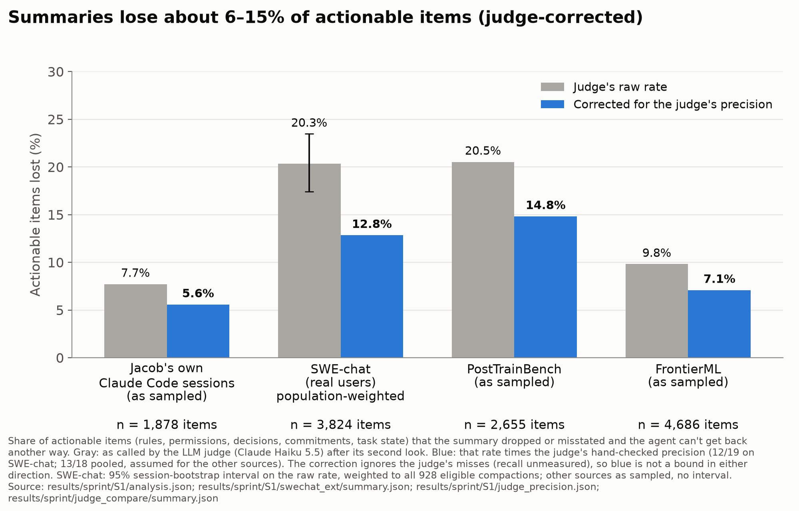
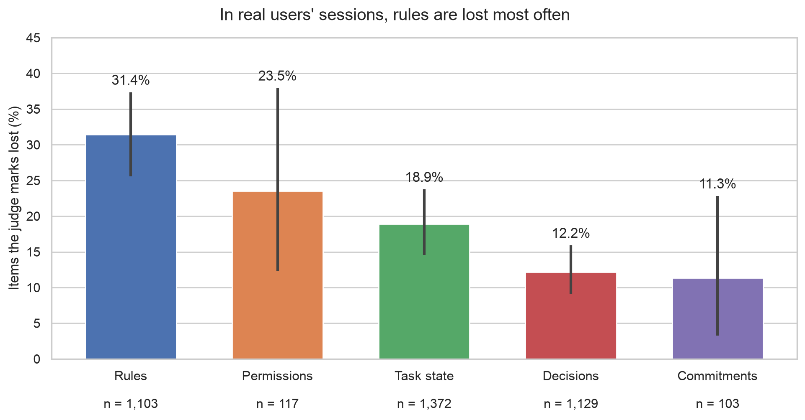
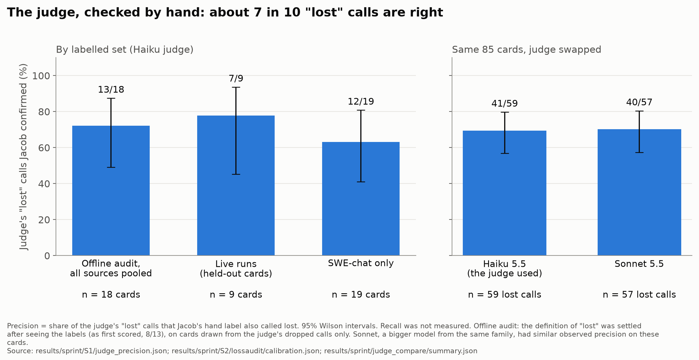
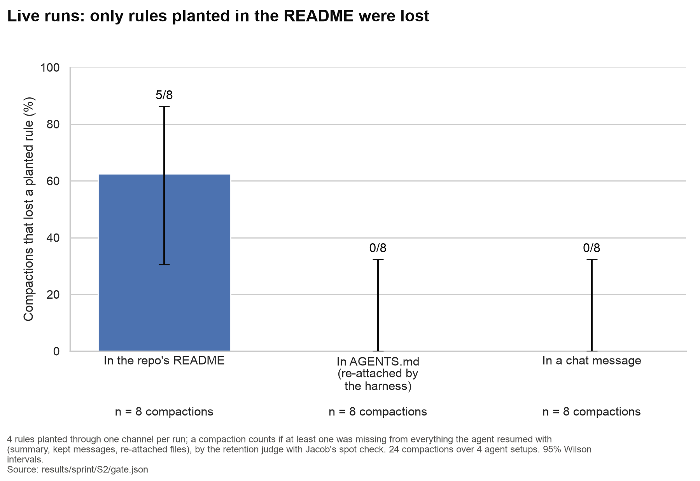
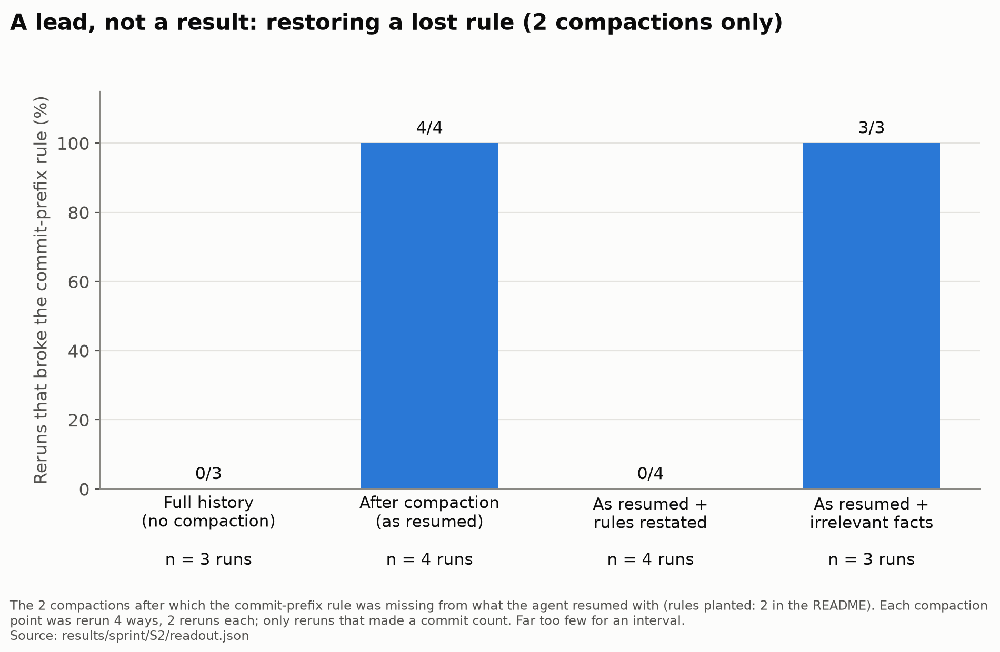
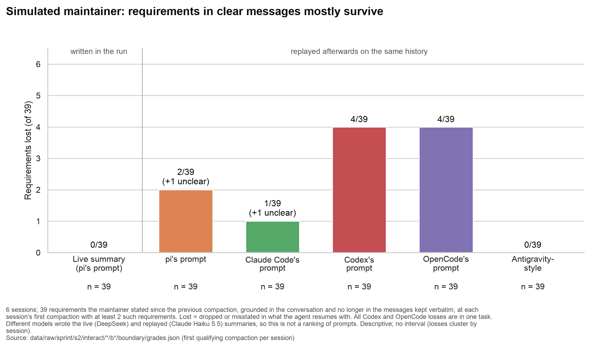
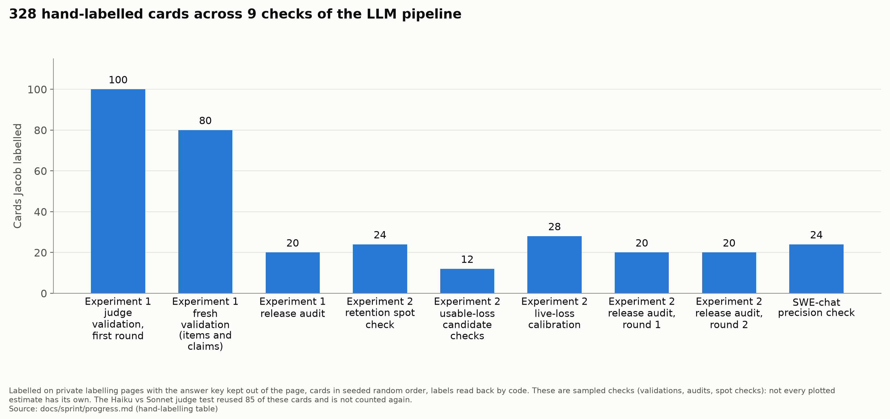

# Sprint figures

Generated by `scripts/sprint_figs.py` (`uv run python scripts/sprint_figs.py`); every number below is read from the listed file at run time. PNG (200 dpi) and SVG for each chart.

## 01_loss_by_source: Summaries lose about 6–15% of actionable items (judge-corrected)

**Claim:** Judge rates 8-21% of actionable items lost; about 6-15% after the precision correction.

**Source:**
- `results/sprint/S1/analysis.json` (part_a.haiku-max.items.type_x_source, summed over types)
- `results/sprint/S1/swechat_ext/summary.json` (sets.population_estimate.pooled.lost_rate)
- `results/sprint/S1/judge_precision.json` (haiku-max.lost; footer)
- `results/sprint/judge_compare/summary.json` (metrics.by_set.swechat_ext.haiku; footer)

| Bar | Numbers plotted |
|---|---|
| Jacob's own Claude Code sessions (as sampled) | 145/1,878 = 7.7% (no interval computed); corrected x 0.72 = 5.6% |
| SWE-chat (real users) population-weighted | 20.3% [17.4, 23.5]; 3,824 items (observed, unweighted); corrected x 0.63 = 12.8% |
| PostTrainBench (as sampled) | 545/2,655 = 20.5% (no interval computed); corrected x 0.72 = 14.8% |
| FrontierML (as sampled) | 460/4,686 = 9.8% (no interval computed); corrected x 0.72 = 7.1% |

- Footer: judge precision 13/18 pooled, 12/19 on SWE-chat; 928 eligible SWE-chat compactions (pool_size + Experiment 1's records); judge Claude Haiku 5.5.

## 02_swechat_by_type: In real users' sessions, rules are lost most often

**Claim:** Rules and permissions are lost most; decisions and commitments least.

**Source:**
- `results/sprint/S1/swechat_ext/summary.json` (population_design.primary.lost_<type>; n from sets.population_estimate.lost_by_type)

| Bar | Numbers plotted |
|---|---|
| Rules | 31.4% [25.6, 37.3]; 1,103 items |
| Permissions | 23.5% [12.3, 37.9]; 117 items |
| Task state | 18.9% [14.6, 23.7]; 1,372 items |
| Decisions | 12.2% [9.0, 15.9]; 1,129 items |
| Commitments | 11.3% [3.3, 22.8]; 103 items |

- Footer: 250 records at weight 1 plus 50 of 678 at 13.56 (population_estimate_weights, n_extension_judged, pool_size); judge Claude Haiku 5.5.

## 03_judge_precision: The judge, checked by hand: about 7 in 10 "lost" calls are right

**Claim:** Judge precision is 0.63-0.78 by set; Sonnet's observed precision on the same cards is similar.

**Source:**
- `results/sprint/S1/judge_precision.json` (haiku-max.lost)
- `results/sprint/S2/lossaudit/calibration.json` (heldout.precision_lost)
- `results/sprint/judge_compare/summary.json` (metrics.by_set.swechat_ext.haiku; metrics.overall)

| Bar | Numbers plotted |
|---|---|
| Offline audit, all sources pooled | 13/18 = 0.72 Wilson [0.49, 0.88] |
| Live runs (held-out cards) | 7/9 = 0.78 Wilson [0.45, 0.94] |
| SWE-chat only | 12/19 = 0.63 Wilson [0.41, 0.81] |
| Haiku 5.5 (the judge used) | 41/59 = 0.69 Wilson [0.57, 0.80] |
| Sonnet 5.5 | 40/57 = 0.70 Wilson [0.57, 0.80] |

- Title: 41/59 rounded to tenths (metrics.overall.haiku.precision_lost).
- Footer: definition settled after labels (judge_precision.json definition_settled_after_labels, measured_on); as first scored 8/13 (parsed from its note).

## 04_live_rules_by_channel: Live runs: only rules planted in the README were lost

**Claim:** README rules were lost at 5/8 compactions; no loss was observed from AGENTS.md or chat (0/8, 0/8).

**Source:**
- `results/sprint/S2/gate.json` (tiers tallied; matches q2_yield and agents_md_descriptive)

| Bar | Numbers plotted |
|---|---|
| In the repo's README | 5/8 = 62.5% Wilson [30.6, 86.3] |
| In AGENTS.md (re-attached by the harness) | 0/8 = 0.0% Wilson [0.0, 32.4] |
| In a chat message | 0/8 = 0.0% Wilson [0.0, 32.4] |

- Footer: 4 rules per run (labels per tier); 24 compactions, 4 setups.

## 05_live_prefix_rule_by_arm: A lead, not a result: restoring a lost rule (2 compactions only)

**Claim:** At the 2 compactions that lost the rule, as-resumed and irrelevant-fact reruns broke it; full-history and rules-restated reruns did not.

**Source:**
- `results/sprint/S2/readout.json` (rules.R6.lost.contrasts: a_k/a_n and b_k/b_n per arm)

| Bar | Numbers plotted |
|---|---|
| Full history (no compaction) | 0/3 |
| After compaction (as resumed) | 4/4 |
| As resumed + rules restated | 0/4 |
| As resumed + irrelevant facts | 3/3 |

- 2 compactions, channels {'readme': 2}; descriptive, too_small in the file.
- Footer: 4 arms x 2 reruns = arms_per_boundary key 8.

## 06_maintainer_requirements_lost: Simulated maintainer: requirements in clear messages mostly survive

**Claim:** Few requirements are lost: replays lose 0-4 of 39, the live summary 0.

**Source:**
- `data/raw/sprint/s2/interact/boa-hierarchical-evaluation-cancellation-deepseek-a1/b2/boundary/grades.json` (sha256 cd7c9c4f57c2823c)
- `data/raw/sprint/s2/interact/boa-hierarchical-evaluation-cancellation-deepseek-a1/b2/boundary/eligibility.json` (sha256 20a8749c9609617b)
- `data/raw/sprint/s2/interact/boa-hierarchical-evaluation-cancellation-deepseek-a1/run.json` (sha256 78fb93741e0e665f)
- `data/raw/sprint/s2/interact/boa-hierarchical-evaluation-cancellation-deepseek-a1/b2/boundary/replays/pi/replay.json` (sha256 1293120b2147a4b5)
- `data/raw/sprint/s2/interact/boa-hierarchical-evaluation-cancellation-deepseek-a1/b2/boundary/replays/cc_prompt/replay.json` (sha256 7412a994a8bc02da)
- `data/raw/sprint/s2/interact/boa-hierarchical-evaluation-cancellation-deepseek-a1/b2/boundary/replays/codex_local/replay.json` (sha256 cf2e9e6091cb90d4)
- `data/raw/sprint/s2/interact/boa-hierarchical-evaluation-cancellation-deepseek-a1/b2/boundary/replays/opencode/replay.json` (sha256 57050294e587cbea)
- `data/raw/sprint/s2/interact/boa-hierarchical-evaluation-cancellation-deepseek-a1/b2/boundary/replays/antigravity/replay.json` (sha256 55e406207aa8dcd7)
- `data/raw/sprint/s2/interact/fastapi-implicit-head-options-deepseek-a1/b1/boundary/grades.json` (sha256 9eda8d3500772bbc)
- `data/raw/sprint/s2/interact/fastapi-implicit-head-options-deepseek-a1/b1/boundary/eligibility.json` (sha256 cce71d6348e36615)
- `data/raw/sprint/s2/interact/fastapi-implicit-head-options-deepseek-a1/run.json` (sha256 206229d0d2888759)
- `data/raw/sprint/s2/interact/fastapi-implicit-head-options-deepseek-a1/b1/boundary/replays/pi/replay.json` (sha256 754823f7f4bd9415)
- `data/raw/sprint/s2/interact/fastapi-implicit-head-options-deepseek-a1/b1/boundary/replays/cc_prompt/replay.json` (sha256 5a5d0c4db0b2117f)
- `data/raw/sprint/s2/interact/fastapi-implicit-head-options-deepseek-a1/b1/boundary/replays/codex_local/replay.json` (sha256 8ef75b47c87beab8)
- `data/raw/sprint/s2/interact/fastapi-implicit-head-options-deepseek-a1/b1/boundary/replays/opencode/replay.json` (sha256 006e3fc39cc23295)
- `data/raw/sprint/s2/interact/fastapi-implicit-head-options-deepseek-a1/b1/boundary/replays/antigravity/replay.json` (sha256 180ef115a40fc6cb)
- `data/raw/sprint/s2/interact/helm-array-merge-strategies-deepseek-a2/b1/boundary/grades.json` (sha256 df52da0076b1d908)
- `data/raw/sprint/s2/interact/helm-array-merge-strategies-deepseek-a2/b1/boundary/eligibility.json` (sha256 1b4017d09f2eecc7)
- `data/raw/sprint/s2/interact/helm-array-merge-strategies-deepseek-a2/run.json` (sha256 e64c183d2ea7935b)
- `data/raw/sprint/s2/interact/helm-array-merge-strategies-deepseek-a2/b1/boundary/replays/pi/replay.json` (sha256 6e8b07e51596cd3b)
- `data/raw/sprint/s2/interact/helm-array-merge-strategies-deepseek-a2/b1/boundary/replays/cc_prompt/replay.json` (sha256 5ee3f28977984e13)
- `data/raw/sprint/s2/interact/helm-array-merge-strategies-deepseek-a2/b1/boundary/replays/codex_local/replay.json` (sha256 aee86d52422df1bb)
- `data/raw/sprint/s2/interact/helm-array-merge-strategies-deepseek-a2/b1/boundary/replays/opencode/replay.json` (sha256 b255bf9ad8549ac6)
- `data/raw/sprint/s2/interact/helm-array-merge-strategies-deepseek-a2/b1/boundary/replays/antigravity/replay.json` (sha256 8daf261c5ed7c6e9)
- `data/raw/sprint/s2/interact/kombu-single-active-consumer-priority-deepseek-a1/b2/boundary/grades.json` (sha256 4500a63cd815926f)
- `data/raw/sprint/s2/interact/kombu-single-active-consumer-priority-deepseek-a1/b2/boundary/eligibility.json` (sha256 48c59c857d8c40b9)
- `data/raw/sprint/s2/interact/kombu-single-active-consumer-priority-deepseek-a1/run.json` (sha256 d5c646e599b79060)
- `data/raw/sprint/s2/interact/kombu-single-active-consumer-priority-deepseek-a1/b2/boundary/replays/pi/replay.json` (sha256 d1bd65f667be9e0e)
- `data/raw/sprint/s2/interact/kombu-single-active-consumer-priority-deepseek-a1/b2/boundary/replays/cc_prompt/replay.json` (sha256 53719db79a99f676)
- `data/raw/sprint/s2/interact/kombu-single-active-consumer-priority-deepseek-a1/b2/boundary/replays/codex_local/replay.json` (sha256 f3a9339264a11ccc)
- `data/raw/sprint/s2/interact/kombu-single-active-consumer-priority-deepseek-a1/b2/boundary/replays/opencode/replay.json` (sha256 56c7579e881ccd35)
- `data/raw/sprint/s2/interact/kombu-single-active-consumer-priority-deepseek-a1/b2/boundary/replays/antigravity/replay.json` (sha256 1d0ba5ee99ceb90a)
- `data/raw/sprint/s2/interact/testem-bail-on-test-failure-deepseek-a1/b1/boundary/grades.json` (sha256 4f19f16c6665e241)
- `data/raw/sprint/s2/interact/testem-bail-on-test-failure-deepseek-a1/b1/boundary/eligibility.json` (sha256 d2bf8359066266b4)
- `data/raw/sprint/s2/interact/testem-bail-on-test-failure-deepseek-a1/run.json` (sha256 705e51b55b6c532a)
- `data/raw/sprint/s2/interact/testem-bail-on-test-failure-deepseek-a1/b1/boundary/replays/pi/replay.json` (sha256 f805b6e8aa2f9b39)
- `data/raw/sprint/s2/interact/testem-bail-on-test-failure-deepseek-a1/b1/boundary/replays/cc_prompt/replay.json` (sha256 f1ec9fb96cd040bd)
- `data/raw/sprint/s2/interact/testem-bail-on-test-failure-deepseek-a1/b1/boundary/replays/codex_local/replay.json` (sha256 22c7bc3454efaa34)
- `data/raw/sprint/s2/interact/testem-bail-on-test-failure-deepseek-a1/b1/boundary/replays/opencode/replay.json` (sha256 78991b793611cba6)
- `data/raw/sprint/s2/interact/testem-bail-on-test-failure-deepseek-a1/b1/boundary/replays/antigravity/replay.json` (sha256 16170cf21ac36c17)
- `data/raw/sprint/s2/interact/vitest-duration-sharding-deepseek-a1/b1/boundary/grades.json` (sha256 84a8e5765fd12890)
- `data/raw/sprint/s2/interact/vitest-duration-sharding-deepseek-a1/b1/boundary/eligibility.json` (sha256 82ffb7f22ac94563)
- `data/raw/sprint/s2/interact/vitest-duration-sharding-deepseek-a1/run.json` (sha256 fa6e79a7ffa912b0)
- `data/raw/sprint/s2/interact/vitest-duration-sharding-deepseek-a1/b1/boundary/replays/pi/replay.json` (sha256 e6ad7e853d23b59e)
- `data/raw/sprint/s2/interact/vitest-duration-sharding-deepseek-a1/b1/boundary/replays/cc_prompt/replay.json` (sha256 795e4cabf80c61e6)
- `data/raw/sprint/s2/interact/vitest-duration-sharding-deepseek-a1/b1/boundary/replays/codex_local/replay.json` (sha256 2658d03f89694e01)
- `data/raw/sprint/s2/interact/vitest-duration-sharding-deepseek-a1/b1/boundary/replays/opencode/replay.json` (sha256 27ade1ba0ffd164d)
- `data/raw/sprint/s2/interact/vitest-duration-sharding-deepseek-a1/b1/boundary/replays/antigravity/replay.json` (sha256 db3ed89427319335)

| Bar | Numbers plotted |
|---|---|
| Live summary (pi's prompt) | 0/39 lost, 0 unclear; sessions with a loss: 0 |
| pi's prompt | 2/39 lost, 1 unclear; sessions with a loss: 2 |
| Claude Code's prompt | 1/39 lost, 1 unclear; sessions with a loss: 1 |
| Codex's prompt | 4/39 lost, 0 unclear; sessions with a loss: 1 |
| OpenCode's prompt | 4/39 lost, 0 unclear; sessions with a loss: 1 |
| Antigravity-style | 0/39 lost, 0 unclear; sessions with a loss: 0 |

- Sessions: boa-hierarchical-evaluation-cancellation-deepseek-a1, fastapi-implicit-head-options-deepseek-a1, helm-array-merge-strategies-deepseek-a2, kombu-single-active-consumer-priority-deepseek-a1, testem-bail-on-test-failure-deepseek-a1, vitest-duration-sharding-deepseek-a1.
- Codex/OpenCode losses in: testem-bail-on-test-failure-deepseek-a1.
- These raw files are gitignored (data/raw/), not committed.
- Footer: qualifying = eligible with at least min_fresh = 2 fresh requirements (eligibility.json); fresh excludes in-tail, inherited and ungrounded requirements.

## 07_hand_labels: 328 hand-labelled cards across 9 checks of the LLM pipeline

**Claim:** 328 hand-labelled cards across 9 checks.

**Source:**
- `docs/sprint/progress.md` (table under "Hand labelling")

| Bar | Numbers plotted |
|---|---|
| Experiment 1 judge validation, first round | 100 |
| Experiment 1 fresh validation (items and claims) | 80 |
| Experiment 1 release audit | 20 |
| Experiment 2 retention spot check | 24 |
| Experiment 2 usable-loss candidate checks | 12 |
| Experiment 2 live-loss calibration | 28 |
| Experiment 2 release audit, round 1 | 20 |
| Experiment 2 release audit, round 2 | 20 |
| SWE-chat precision check | 24 |

- Total row in the file: 328.

## Where the files differ from the brief (`logs/s2/briefs/sprint-figs.md`)

- **Chart 6 denominators:** the brief says 37 requirements over 5 sessions; the files give 39 over 6. The difference is helm's rerun (its first attempt crashed), whose requirements every summary kept; `docs/sprint/progress.md` gives the same total in its go-line entry. The brief also omits the unclear grades (pi's prompt 1, Claude Code's prompt 1), shown on the chart. Loss counts match the brief.
- **Chart 6 sources are not committed:** the brief points at `data/raw/sprint/s2/interact/`, which is gitignored, against its own "committed files only" rule. The script reads them as named and records each file's sha256 above.
- **Style:** `docs/pitch/make_figs.py` does not exist; the conventions of `docs/pitch/fig_*.py` were followed instead.
