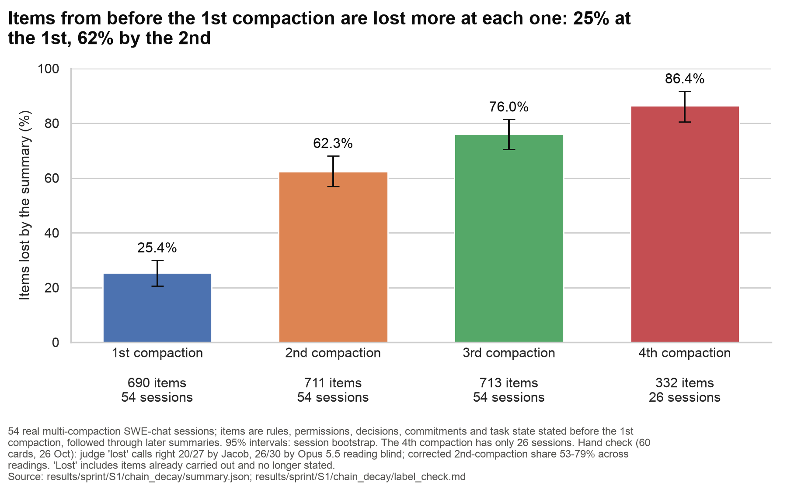
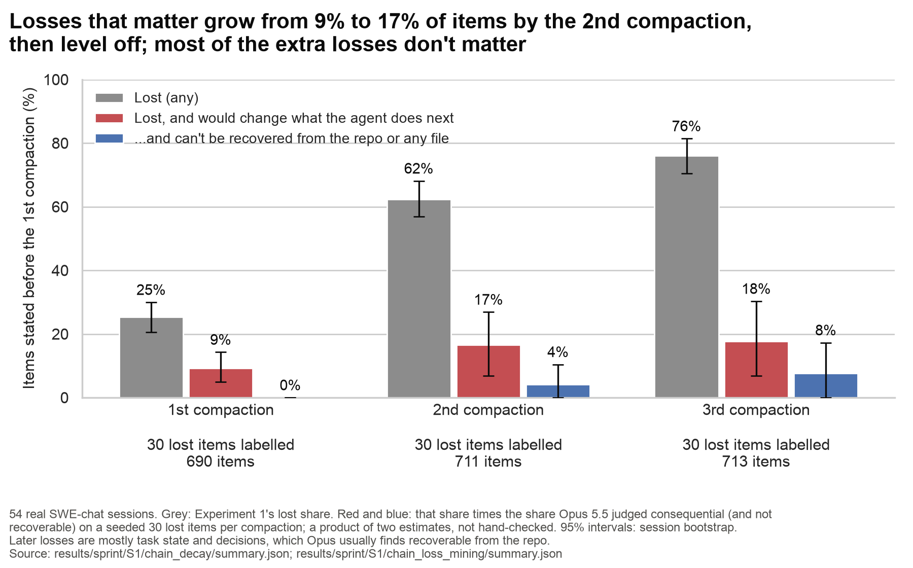

# SWE-chat chain-decay figure

Generated by `scripts/sprint_figs_chain.py` (`uv run python scripts/sprint_figs_chain.py`); every number is read from the listed committed file at run time. PNG (200 dpi) and SVG.

## 01_chain_decay: Items from before the 1st compaction are lost more at each one: 25% at the 1st, 62% by the 2nd

**Claim:** share of items stated before the 1st compaction that the summary at compaction k has lost (Experiment 1's definition: dropped or misstated, and not available another way), uncensored row.

**Source:** `results/sprint/S1/chain_decay/summary.json` (cohort1.lost_by_k_uncensored[k].all); footer figures from `results/sprint/S1/chain_decay/label_check.md`.

**Numbers plotted:**
- 1st compaction: 25.4% [20.6, 30.0]; 690 items, 54 sessions
- 2nd compaction: 62.3% [56.9, 68.1]; 711 items, 54 sessions
- 3rd compaction: 76.0% [70.5, 81.4]; 713 items, 54 sessions
- 4th compaction: 86.4% [80.5, 91.7]; 332 items, 26 sessions

- Note: the uncensored row counts every item; the censored row (items a later stretch showed no longer current dropped) differs by about 2 points at k=2 and 3. Later compactions (5-8) have 7-12 sessions and are left out.

## 02_lost_and_matters: Losses that matter grow from 9% to 17% of items by the 2nd compaction, then level off; most of the extra losses don't matter

**Source:** `results/sprint/S1/chain_decay/summary.json` (grey) and `results/sprint/S1/chain_loss_mining/summary.json` (implied_lost_and_matters).

**Numbers plotted:**
- Lost (any): k=1 25.4% [20.6, 30.0]; k=2 62.3% [56.9, 68.1]; k=3 76.0% [70.5, 81.4]
- Lost, and would change what the agent does next: k=1 9.3% [5.0, 14.3]; k=2 16.6% [6.9, 26.9]; k=3 17.7% [6.8, 30.3]
- ...and can't be recovered from the repo or any file: k=1 0.0% [0.0, 0.0]; k=2 4.2% [0.0, 10.4]; k=3 7.6% [0.0, 17.3]
