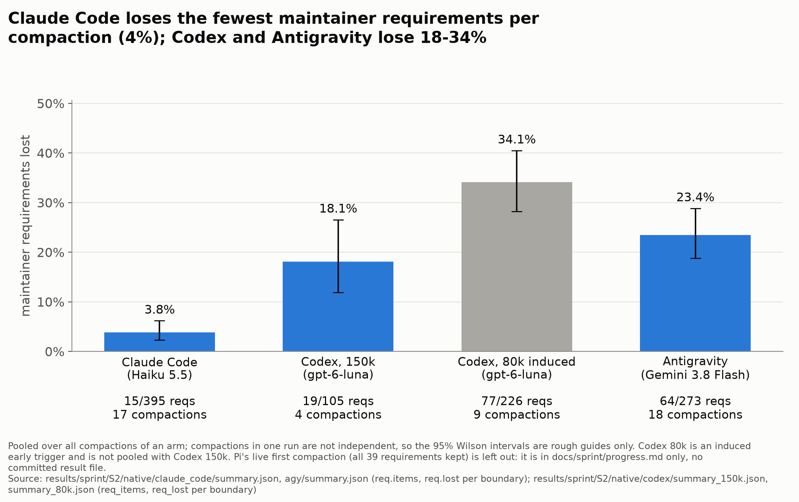
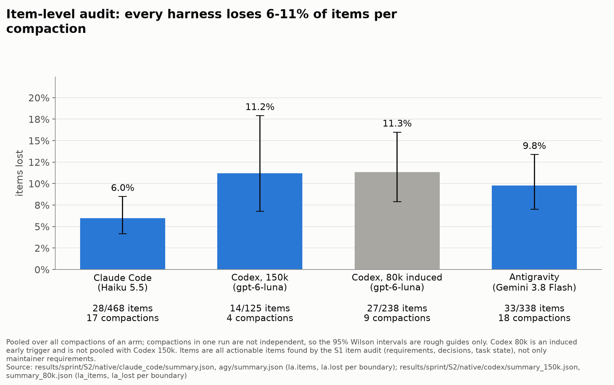
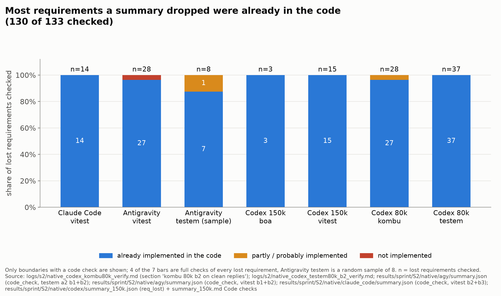
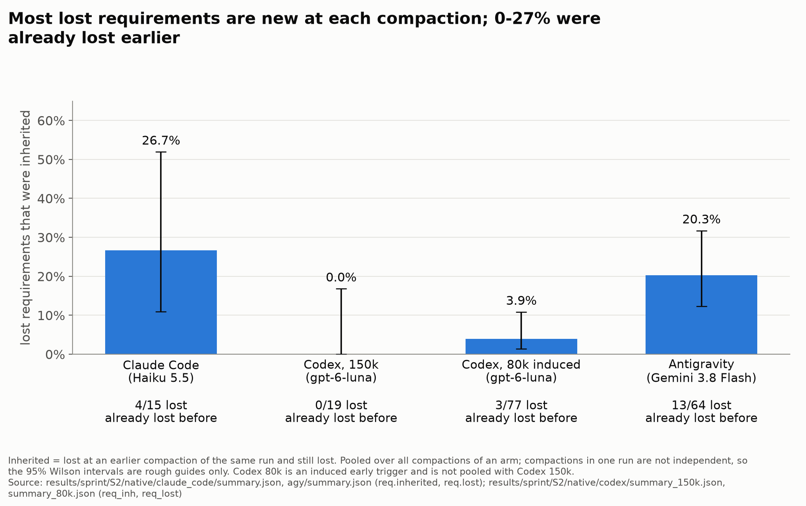
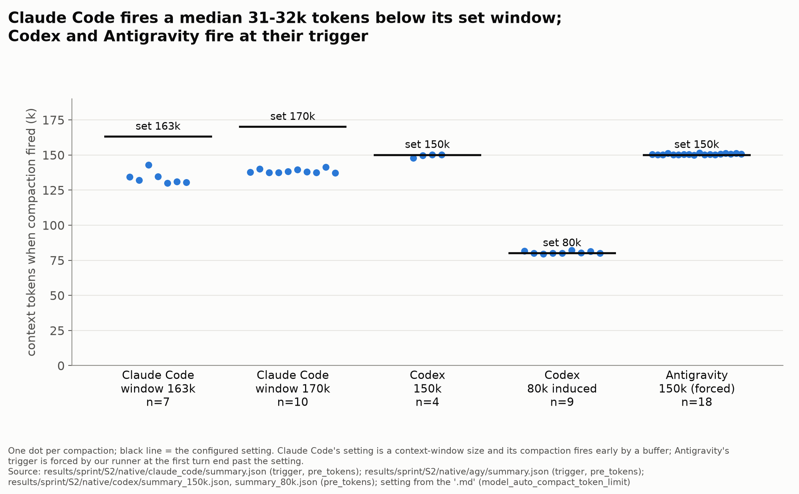
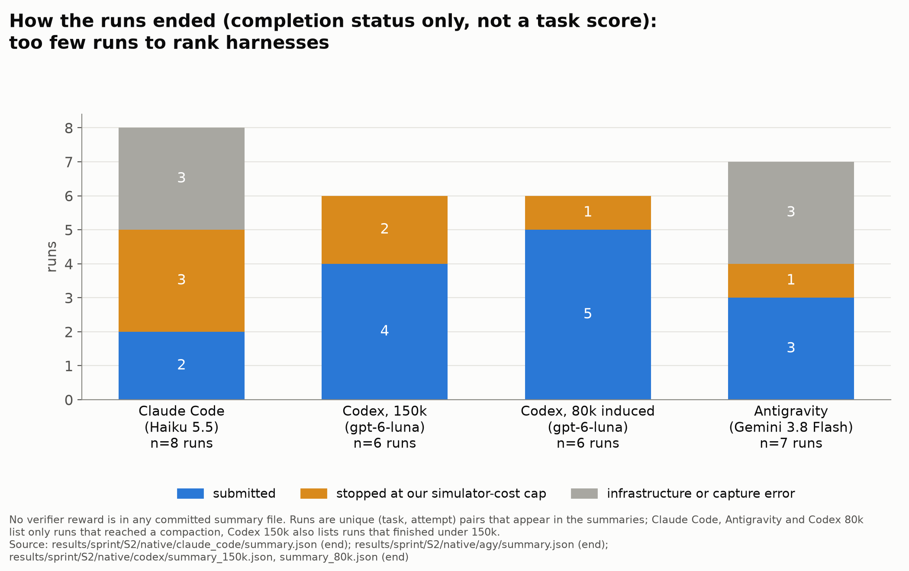
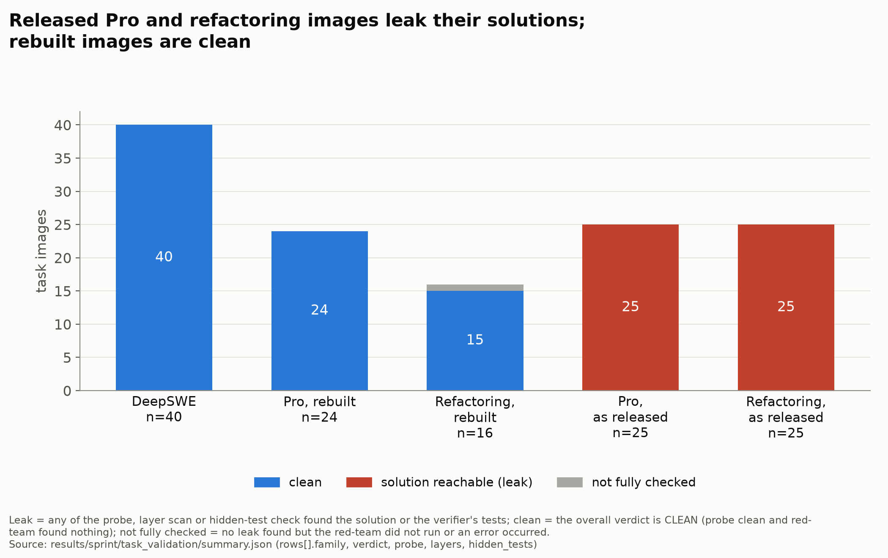

# Native-harness figures

Generated by `scripts/sprint_figs_native.py` (`uv run python scripts/sprint_figs_native.py`); every number is read from the listed committed file at run time. PNG (200 dpi) and SVG for each chart. Model names: Claude Code (Haiku 5.5), Codex (gpt-6-luna), Antigravity (Gemini 3.8 Flash).

**Pooling.** Bars pool all compactions (boundaries) of an arm. Compactions inside one run are not independent, and arms differ in tasks, attempts and number of boundaries, so the 95% Wilson intervals are rough guides, not tests. Codex 80k is an induced early trigger and is never pooled with Codex 150k. Pi (DeepSeek V4 Flash): its live first compaction kept all 39 of 39 requirements, but that figure is only in `docs/sprint/progress.md`, with no committed result file, so pi is left out of the charts.

## 01_requirements_lost_by_harness: Claude Code loses the fewest maintainer requirements per compaction (4%); Codex and Antigravity lose 18-34%

**Claim:** Share of maintainer requirements stated before a compaction that the summary lost, pooled over boundaries.

**Source:**
- `results/sprint/S2/native/claude_code/summary.json, agy/summary.json (req.items, req.lost per boundary)`
- `results/sprint/S2/native/codex/summary_150k.json, summary_80k.json (req_items, req_lost per boundary)`

**Numbers plotted:**
- Claude Code (Haiku 5.5): 15/395 = 3.8% [2.3, 6.2]; 17 compactions
- Codex, 150k (gpt-6-luna): 19/105 = 18.1% [11.9, 26.5]; 4 compactions
- Codex, 80k induced (gpt-6-luna): 77/226 = 34.1% [28.2, 40.5]; 9 compactions
- Antigravity (Gemini 3.8 Flash): 64/273 = 23.4% [18.8, 28.8]; 18 compactions

- Note: Pooled over all compactions of an arm; compactions in one run are not independent, so the 95% Wilson intervals are rough guides only. Codex 80k is an induced early trigger and is not pooled with Codex 150k. Pi's live first compaction (all 39 requirements kept) is left out: it is in docs/sprint/progress.md only, no committed result file.

## 02_items_lost_by_harness: Item-level audit: every harness loses 6-11% of items per compaction

**Claim:** Share of audited items lost by the summary, pooled over boundaries.

**Source:**
- `results/sprint/S2/native/claude_code/summary.json, agy/summary.json (la.items, la.lost per boundary)`
- `results/sprint/S2/native/codex/summary_150k.json, summary_80k.json (la_items, la_lost per boundary)`

**Numbers plotted:**
- Claude Code (Haiku 5.5): 28/468 = 6.0% [4.2, 8.5]; 17 compactions
- Codex, 150k (gpt-6-luna): 14/125 = 11.2% [6.8, 17.9]; 4 compactions
- Codex, 80k induced (gpt-6-luna): 27/238 = 11.3% [7.9, 16.0]; 9 compactions
- Antigravity (Gemini 3.8 Flash): 33/338 = 9.8% [7.0, 13.4]; 18 compactions

- Note: Pooled over all compactions of an arm; compactions in one run are not independent, so the 95% Wilson intervals are rough guides only. Codex 80k is an induced early trigger and is not pooled with Codex 150k. Items are all actionable items found by the S1 item audit (requirements, decisions, task state), not only maintainer requirements.

## 03_lost_requirements_vs_code: Most requirements a summary dropped were already in the code (130 of 133 checked)

**Claim:** Of the requirements the summary lost, how many the agent's code already implemented at that boundary (summary-only loss, no behavioural cost yet).

**Source:**
- `logs/s2/native_codex_kombu80k_verify.md (section 'kombu 80k b2 on clean replies')`
- `logs/s2/native_codex_testem80k_b2_verify.md`
- `results/sprint/S2/native/agy/summary.json (code_check, testem a2 b1+b2)`
- `results/sprint/S2/native/agy/summary.json (code_check, vitest b1+b2)`
- `results/sprint/S2/native/claude_code/summary.json (code_check, vitest b2+b3)`
- `results/sprint/S2/native/codex/summary_150k.json (req_lost) + summary_150k.md Code checks`

**Numbers plotted:**
- Claude Code vitest: implemented 14, partly 0, not 0 (n=14); b3 repeats 4 requirements already lost at b2
- Antigravity vitest: implemented 27, partly 0, not 1 (n=28); the one not implemented was re-raised by the maintainer
- Antigravity testem (sample): implemented 7, partly 1, not 0 (n=8); random sample of 8 lost requirements, not all of them
- Codex 150k boa: implemented 3, partly 0, not 0 (n=3); 2 of 3 read in the patches, not executed
- Codex 150k vitest: implemented 15, partly 0, not 0 (n=15); 
- Codex 80k kombu: implemented 27, partly 1, not 0 (n=28); 'probably implemented' shown as partly
- Codex 80k testem: implemented 37, partly 0, not 0 (n=37); 6 of 37 fail hidden tests for reasons traced to maintainer replies

- Note: Not pooled across bars; counts are per check set. Each bar's source is listed in the table above. Code checks are reading the code or running the task's hidden tests; 'implemented' for Codex testem includes 6 whose hidden tests fail for reasons traced to the maintainer's own replies, not the summary.

## 04_inherited_vs_new_losses: Most lost requirements are new at each compaction; 0-27% were already lost earlier

**Claim:** Of the requirements lost at a boundary, the share the previous summary had already lost.

**Source:**
- `results/sprint/S2/native/claude_code/summary.json, agy/summary.json (req.inherited, req.lost)`
- `results/sprint/S2/native/codex/summary_150k.json, summary_80k.json (req_inh, req_lost)`

**Numbers plotted:**
- Claude Code (Haiku 5.5): 4/15 = 26.7% [10.9, 52.0]; new 11
- Codex, 150k (gpt-6-luna): 0/19 = 0.0% [0.0, 16.8]; new 19
- Codex, 80k induced (gpt-6-luna): 3/77 = 3.9% [1.3, 10.8]; new 74
- Antigravity (Gemini 3.8 Flash): 13/64 = 20.3% [12.3, 31.7]; new 51

- Note: Arms have different numbers of boundaries (a second boundary can inherit, a first cannot), so shares are not a like-for-like comparison. 'Unknown' grades (none in these files) would be counted as neither.

## 05_trigger_point_by_harness: Claude Code fires a median 31-32k tokens below its set window; Codex and Antigravity fire at their trigger

**Claim:** Actual context size at each compaction against the configured setting.

**Source:**
- `results/sprint/S2/native/claude_code/summary.json (trigger, pre_tokens)`
- `results/sprint/S2/native/agy/summary.json (trigger, pre_tokens)`
- `results/sprint/S2/native/codex/summary_150k.json, summary_80k.json (pre_tokens); setting from the '.md' (model_auto_compact_token_limit)`

**Numbers plotted:**
- Claude Code window 163k: n=7; pre_tokens min 130,037 / median 132,113 / max 142,838; setting 163,000
- Claude Code window 170k: n=10; pre_tokens min 137,229 / median 137,776 / max 141,297; setting 170,000
- Codex 150k: n=4; pre_tokens min 147,824 / median 149,904 / max 150,229; setting 150,000
- Codex 80k induced: n=9; pre_tokens min 79,515 / median 80,160 / max 82,160; setting 80,000
- Antigravity 150k (forced): n=18; pre_tokens min 150,000 / median 150,367 / max 151,517; setting 150,000

- Note: Claude Code's first calibration batch used window 163,000; the rest 170,000 (logs/s2/native_arms_report.md, Thresholds).

## 06_run_end_states_by_harness: How the runs ended (completion status only, not a task score): too few runs to rank harnesses

**Claim:** Run end state per harness; this is completion status, not a score.

**Source:**
- `results/sprint/S2/native/claude_code/summary.json (end)`
- `results/sprint/S2/native/agy/summary.json (end)`
- `results/sprint/S2/native/codex/summary_150k.json, summary_80k.json (end)`

**Numbers plotted:**
- Claude Code (Haiku 5.5): submitted 2, run_cap 3, error 3 (n=8)
- Codex, 150k (gpt-6-luna): submitted 4, run_cap 2, error 0 (n=6)
- Codex, 80k induced (gpt-6-luna): submitted 5, run_cap 1, error 0 (n=6)
- Antigravity (Gemini 3.8 Flash): submitted 3, run_cap 1, error 3 (n=7)

- Note: Different harnesses, models, caps and attempts: the end state mostly reflects infrastructure faults and the simulator-cost cap, not agent ability. A few verifier results exist for single Codex runs in logs/s2/native_codex_*_verify.md (vitest 150k reward 0, partial 0.9625; kombu 80k reward 1) but none for Claude Code or Antigravity in committed files; per-run result.json lives in gitignored data/raw/sprint/s2/native/ and holds only run_key, end, and timings.

## 07_image_leak_validation: Released Pro and refactoring images leak their solutions; rebuilt images are clean

**Claim:** Leak status of each task image set.

**Source:**
- `results/sprint/task_validation/summary.json (rows[].family, verdict, probe, layers, hidden_tests)`

**Numbers plotted:**
- DeepSWE: CLEAN 40, LEAK 0, UNCHECKED 0
- Pro, rebuilt: CLEAN 24, LEAK 0, UNCHECKED 0
- Refactoring, rebuilt: CLEAN 15, LEAK 0, UNCHECKED 1
- Pro, as released: CLEAN 0, LEAK 25, UNCHECKED 0
- Refactoring, as released: CLEAN 0, LEAK 25, UNCHECKED 0

- Note: For the as-released refactoring images the overall verdict is ERROR/LEAK (red-team not run); they are shown as leaking because the layer scan found solution needles in all 25. The verdict column alone would give LEAK 3, ERROR 22.

## Task scores by harness

No verifier reward or score is recorded in any committed summary file for Claude Code, Antigravity or Codex (the summaries hold counts, grades and `end` only), so chart 06 shows completion status. A handful of single-run verifier results appear in the Codex verify docs. With 4 to 16 runs per harness, different tasks, attempts and caps, and ends dominated by infrastructure errors and the simulator-cost cap, no trend by harness or model can be read from these files.
