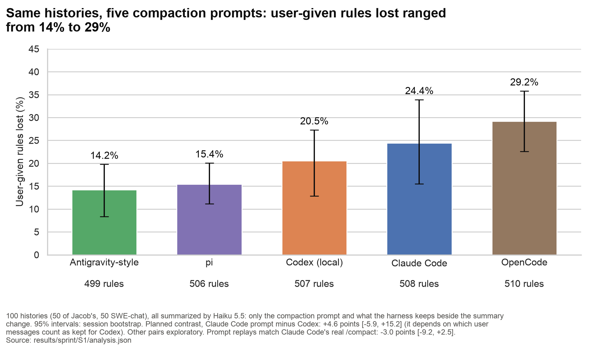

# Summarizer comparison figure

Generated by `scripts/sprint_figs_prompts.py`; every number is read from the source file at run time. PNG (200 dpi) and SVG.

## 01_rules_lost_by_prompt: Same histories, five compaction prompts: user-given rules lost ranged from 14% to 29%

**Claim:** share of user-given rules the summary lost (Experiment 1 definition), per summarizer, on the same 100 histories with Haiku 5.5 as the summarizer.

**Source:** `results/sprint/S1/analysis.json` (part_b.haiku-max.arms[].user_rule_loss_rate, n_user_rules; primary.diff).

**Numbers plotted:**
- Antigravity-style: 14.2% [8.4, 19.8]; 499 rules
- pi: 15.4% [11.1, 20.1]; 506 rules
- Codex (local): 20.5% [12.9, 27.3]; 507 rules
- Claude Code: 24.4% [15.5, 33.9]; 508 rules
- OpenCode: 29.2% [22.6, 35.8]; 510 rules

- Planned contrast (Claude Code prompt minus Codex): +4.6 points [-5.9, +15.2].
- Real /compact minus the Claude Code prompt replay (footer only): -3.0 points [-9.2, +2.5] (exploratory.cc_native-cc_prompt).
