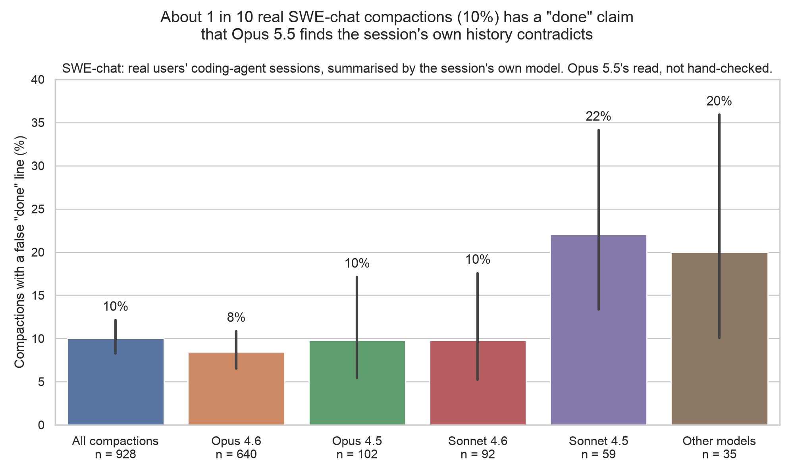

# SWE-chat false-"done" figure

Generated by `scripts/swechat_figs.py` (`uv run python scripts/swechat_figs.py`); every number is read from the committed file below at run time. PNG (200 dpi) and SVG. Style: plain seaborn defaults (AGENTS.md "Figures").

## false_done_by_model: About 1 in 10 real SWE-chat compactions (10%) has a "done" claim that Opus 5.5 finds the session's own history contradicts

**Claim:** share of SWE-chat compactions whose summary has at least one completion claim judged false, overall and by the session's model. A completion claim is a summary line matched by the scan's keyword pre-filter (done, fixed, tests pass and similar; `RX` in `scripts/swechat_scan.py`) that Opus 5.5 read as saying work was completed; the numerator counts compactions with at least one such line whose final verdict is "false". Opus 5.5's read, not hand-checked: Opus 5.5 (`claude -p` on Max, effort low) read each tagged line against the pre-compaction history, and a second Opus 5.5 pass rechecked every "false" call and had to quote the contradicting history; a call it could not back with a quote counts as can't tell, and can't tell never counts as false. One false line is enough: it may be about a single fix or test run, not the whole task.

**Source:** `results/sprint/swechat_odd/scan_summary.json` at commit c1c224c8 (fields listed per bar).

**Numbers plotted** (k/n, rate, Wilson 95% interval):

- All compactions: 93/928 = 10.0% [8.3, 12.1] (`final.per_compaction`)
- Opus 4.6: 54/640 = 8.4% [6.5, 10.8] (`by_model.Opus 4.6.per_compaction`)
- Opus 4.5: 10/102 = 9.8% [5.4, 17.1] (`by_model.Opus 4.5.per_compaction`)
- Sonnet 4.6: 9/92 = 9.8% [5.2, 17.6] (`by_model.Sonnet 4.6.per_compaction`)
- Sonnet 4.5: 13/59 = 22.0% [13.4, 34.1] (`by_model.Sonnet 4.5.per_compaction`)
- Other models: 7/35 = 20.0% [10.0, 35.9] (`by_model.other.per_compaction`)

- Notes: "Other models" is 35 compactions under ten other model ids: Opus 4.1, Sonnet 4, Opus 4.7, Haiku 4.5, GPT-5.3 Codex, two GLM versions, one unnamed id, and opencode's spellings of Opus 4.6 and Sonnet 4.6 (one compaction each). 7 of the 35 ran on the opencode harness; every other compaction is Claude Code (from the gitignored `data/raw/sprint/swechat_odd/scan/compactions.jsonl`; not plotted). The model split is observational: models differ in their users, tasks and session mixes, and one session can contribute several compactions, so it is not a model comparison. Sonnet 4.5's Wilson interval does not overlap Opus 4.6's, but their session-cluster bootstrap intervals do (10.1–33.9% against 6.3–10.8%). Overall, the session-cluster bootstrap gives 8.1–12.1% (`final.per_compaction.boot`).
- Sensitivity: the bars count only lines the keyword pre-filter tagged. Using first-pass verdicts throughout, including untagged lines Opus 5.5 flagged as completion claims and judged false, gives 120/928 = 12.9% of compactions; this estimate does not use recheck results (`with_untagged.per_compaction`).
