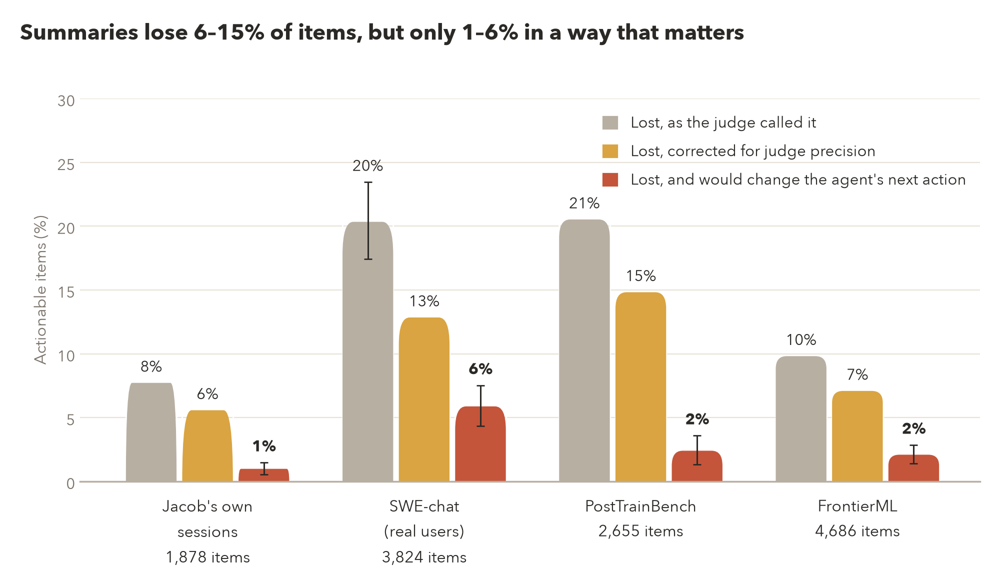
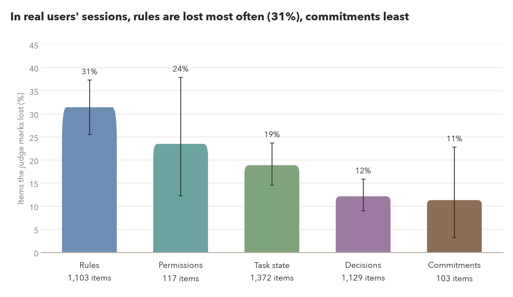
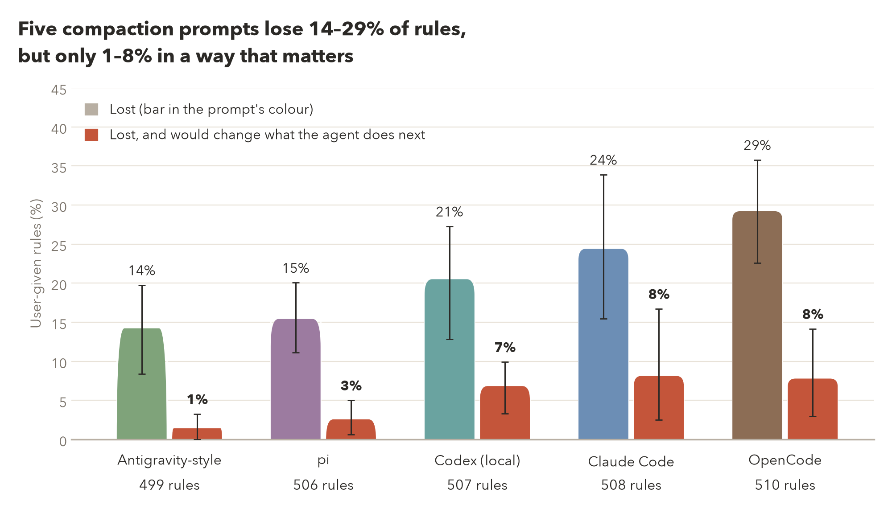
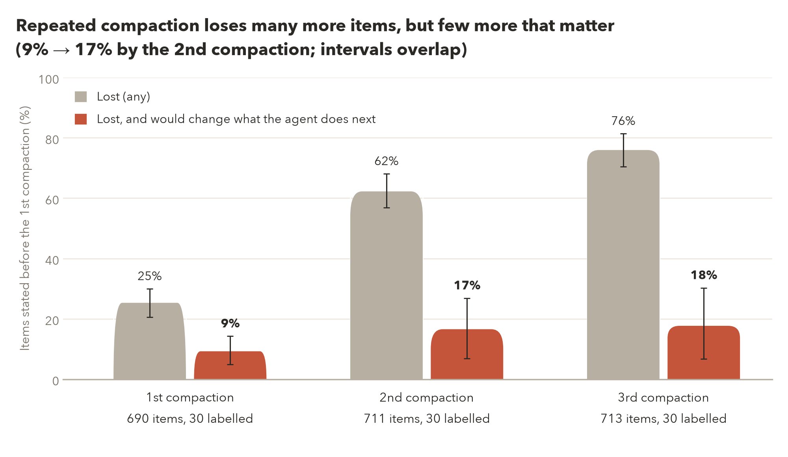
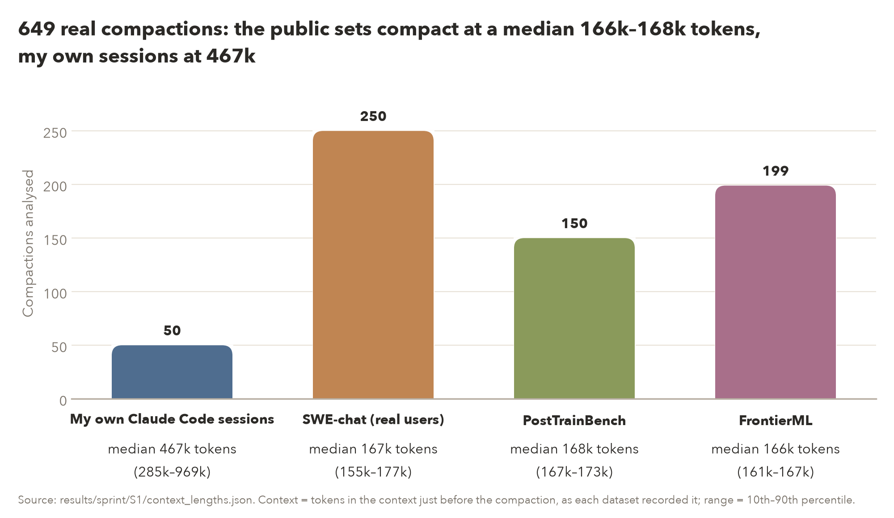
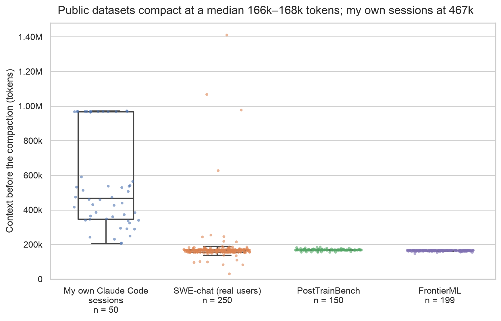

# v2 deck figures

Generated by `scripts/sprint_figs_v2.py` (`uv run python scripts/sprint_figs_v2.py`); every number is read from the listed committed file at run time. PNG (200 dpi) and SVG.

**Style:** AGENTS.md "Figures" (Jacob, 29 Oct): `sns.set_theme(style="whitegrid")` with every other setting at seaborn's default (fonts, text sizes and colours), the default (deep) palette, plain vertical bars and 95% error bars drawn as `sns.barplot` draws them. This replaces the 26 Oct warm-style exception. No captions inside the images (29 Oct): each chart has a one-line title (given below as "Title on the chart"), and its notes and sources are here only.

Colours (deep palette): raw loss grey, precision-corrected orange, lost-and-matters red; each compaction prompt and item type keeps one colour, never one of those three.

## 01_loss_by_source: Summaries lose 6–15% of items, but only 1–6% in a way that matters

**Title on the chart:** Summaries lose 6–15% of items, but only 1–6% in a way that matters

**Claim:** share of actionable items the summary lost, by data source: raw judge rate, precision-corrected rate, and corrected rate times Opus 5.5's consequential share.

**Source:**
- `results/sprint/S1/analysis.json (part_a.haiku-max.items.type_x_source)`
- `results/sprint/S1/swechat_ext/summary.json (sets.population_estimate.pooled)`
- `results/sprint/S1/judge_precision.json (haiku-max.lost)`
- `results/sprint/judge_compare/summary.json (metrics.by_set.swechat_ext.haiku.precision_lost)`
- `results/sprint/S1/loss_mining/labels.jsonl (experiment1 pool, consequential by source)`

**Numbers plotted:**
- Jacob's own sessions: raw 7.7%; corrected x 0.72 = 5.6%; x consequential 12/68 = 1.0% [0.5, 1.5]
- SWE-chat (real users): raw 20.3% [17.4, 23.5]; corrected x 0.63 = 12.8%; x consequential 27/59 = 5.9% [4.3, 7.5]
- PostTrainBench: raw 20.5%; corrected x 0.72 = 14.8%; x consequential 12/74 = 2.4% [1.3, 3.6]
- FrontierML: raw 9.8%; corrected x 0.72 = 7.1%; x consequential 18/61 = 2.1% [1.4, 2.9]

- Notes: SWE-chat is population-weighted with a session-bootstrap interval; the other sources are as sampled, with no interval on the raw rate. The correction ignores the judge's misses (recall unmeasured). Red intervals cover the labelling sample only (compaction bootstrap); 'unclear' counts as no; Opus labels, not hand-checked.

## 02_lost_by_type: In real users' sessions, rules are lost most often (31%), commitments least

**Title on the chart:** In real users' sessions, rules are lost most often (31%), commitments least

**Claim:** share of each item type the judge marks lost in SWE-chat compactions, population-weighted.

**Source:**
- `results/sprint/S1/swechat_ext/summary.json (population_design.primary.lost_<type>; n from sets.population_estimate.lost_by_type)`

**Numbers plotted:**
- Rules: 31.4% [25.6, 37.3]; 1,103 items
- Permissions: 23.5% [12.3, 37.9]; 117 items
- Task state: 18.9% [14.6, 23.7]; 1,372 items
- Decisions: 12.2% [9.0, 15.9]; 1,129 items
- Commitments: 11.3% [3.3, 22.8]; 103 items

- Notes: judge's calls (Claude Haiku 5.5), not precision-corrected; 95% session-bootstrap intervals; n = items observed (unweighted).

## 03_rules_lost_by_prompt: Five compaction prompts lose 14–29% of rules, but only 1–8% in a way that matters

**Title on the chart:** Five compaction prompts lose 14–29% of rules, but only 1–8% in a way that matters

**Claim:** share of user-given rules each replayed compaction prompt lost, and the share lost and consequential, on the same 100 histories with Haiku 5.5 as the summarizer.

**Source:**
- `results/sprint/S1/analysis.json (part_b.haiku-max.arms[].user_rule_loss_rate, n_user_rules)`
- `results/sprint/S1/prompt_loss_mining/summary.json (implied_lost_and_matters[rules|arm].lost_x_consequential)`

**Numbers plotted:**
- Antigravity-style: lost 14.2% [8.4, 19.8]; lost and matters 1.4% [0.0, 3.3]; 499 rules
- pi: lost 15.4% [11.1, 20.1]; lost and matters 2.6% [0.6, 5.0]; 506 rules
- Codex (local): lost 20.5% [12.9, 27.3]; lost and matters 6.8% [3.3, 9.9]; 507 rules
- Claude Code: lost 24.4% [15.5, 33.9]; lost and matters 8.1% [2.5, 16.7]; 508 rules
- OpenCode: lost 29.2% [22.6, 35.8]; lost and matters 7.8% [3.0, 14.2]; 510 rules

- Notes: 95% session-bootstrap intervals; the red bars are the loss rate times Opus 5.5's consequential share on 30 sampled lost rules per prompt ('unclear' counts as no; not hand-checked). The legend's grey swatch stands for each prompt's own colour.

## 04_chain_lost_and_matters: Repeated compaction loses many more items, but few more that matter (9% → 17% by the 2nd compaction; intervals overlap)

**Title on the chart:** Repeated compaction loses many more items, but few more that matter

**Claim:** share of items stated before the 1st compaction that the k-th summary has lost, and lost and consequential, on 54 real multi-compaction SWE-chat sessions.

**Source:**
- `results/sprint/S1/chain_decay/summary.json (cohort1.lost_by_k_uncensored[k].all)`
- `results/sprint/S1/chain_loss_mining/summary.json (implied_lost_and_matters[k].lost_x_consequential; per_k[k].n)`

**Numbers plotted:**
- 1st compaction, lost: 25.4% [20.6, 30.0]
- 1st compaction, lost and matters: 9.3% [5.0, 14.3]
- 2nd compaction, lost: 62.3% [56.9, 68.1]
- 2nd compaction, lost and matters: 16.6% [6.9, 26.9]
- 3rd compaction, lost: 76.0% [70.5, 81.4]
- 3rd compaction, lost and matters: 17.7% [6.8, 30.3]

- Notes: raw judge rates (not precision-corrected); 95% session-bootstrap intervals. Red: the lost share times Opus 5.5's consequential share on 30 seeded lost items per compaction, a product of two estimates, not hand-checked.

<!-- 05_sources_context:start -->
## 05_sources_context: 649 real compactions: the public sets compact at a median 166k–168k tokens, my own sessions at 467k

**Title on the chart:** Public sets compact at a median 166k–168k tokens, my own sessions at 467k

**Claim:** how many of Experiment 1's analysed compactions came from each source, and how large the context was just before each one.

**Source:**
- `results/sprint/S1/context_lengths.json (sources.<source>.n_analysed; sources.<source>.tokens.median, p10, p90, min, max; field pre_tokens)`

**Numbers plotted:**
- My own Claude Code sessions: 50 compactions (50 sampled); context median 466,577.5 tokens, p10 284,642.7, p90 968,714.6, min 205,152, max 972,033
- SWE-chat (real users): 250 compactions (250 sampled); context median 167,268 tokens, p10 155,125.2, p90 176,900.2, min 30,123, max 1,410,364
- PostTrainBench: 150 compactions (150 sampled); context median 167,722 tokens, p10 167,066.7, p90 172,685.5, min 155,042, max 185,085
- FrontierML: 199 compactions (200 sampled); context median 165,676 tokens, p10 161,050.4, p90 166,808.8, min 145,575, max 167,290

- Source line (not on the chart): Source: results/sprint/S1/context_lengths.json. Context = tokens in the context just before the compaction, as each dataset recorded it; range = 10th–90th percentile.
- Notes: `pre_tokens` is each record's dataset-recorded context count before the compaction (Claude Code's compactMetadata.preTokens for my sessions, SWE-chat's Claude Code compactions and PostTrainBench; the summarizer call's input tokens for SWE-chat's 7 OpenCode compactions; for FrontierML, the input count of the preceding main-thread call, a proxy that leaves out that call's output and later tool results). It counts the whole context window, system prompt and tool definitions included, so it is larger than the history text the judge read. Percentiles by numpy.percentile (linear). FrontierML: 199 of 200 analysed (excluded: frontierml:pii-redaction-2abnd8:1, whose claim-judging call failed; roster ok = false). Raw files' sha256 and each sampled line's sha256 were checked against results/sprint/S1/manifest.json. Generated by `scripts/sprint_fig_s1_sources.py`; re-run it after `scripts/sprint_figs_v2.py`, which rewrites this README.
<!-- 05_sources_context:end -->

<!-- 05b_sources_context_size:start -->
## 05b_sources_context_size: Public datasets compact at a median 166k–168k tokens; my own sessions at 467k

**Title on the chart:** Public datasets compact at a median 166k–168k tokens; my own sessions at 467k

**Claim:** the context length (tokens) just before each of Experiment 1's analysed compactions, by source: one point per compaction, with a box plot (median line, quartile box, whiskers to the farthest point within 1.5 IQR; no outlier markers, since every point is drawn).

**Source:**
- `results/sprint/S1/context_lengths.json (sources.<source>.tokens_values, n_analysed; tokens.median, p10, p90, min, max for the numbers below; field pre_tokens)`

**Numbers plotted:**
- My own Claude Code sessions: n = 50 points; median 466,577.5 tokens, p10 284,642.7, p90 968,714.6, min 205,152, max 972,033
- SWE-chat (real users): n = 250 points; median 167,268 tokens, p10 155,125.2, p90 176,900.2, min 30,123, max 1,410,364
- PostTrainBench: n = 150 points; median 167,722 tokens, p10 167,066.7, p90 172,685.5, min 155,042, max 185,085
- FrontierML: n = 199 points; median 165,676 tokens, p10 161,050.4, p90 166,808.8, min 145,575, max 167,290

- Notes: same data and field as 05_sources_context above (see its notes on what `pre_tokens` counts per source). Horizontal jitter only; the y value of each point is exact. FrontierML has 199 points of 200 sampled. Generated by `scripts/sprint_fig_s1_sources.py`.
- Review: gpt-6-astra, logs/reviews/20261029-figs-simplify-r1.md: PASS WITH MINOR FIXES (1 minor, 3 nits; the minor and the title-guard nit fixed, not re-reviewed).
<!-- 05b_sources_context_size:end -->
