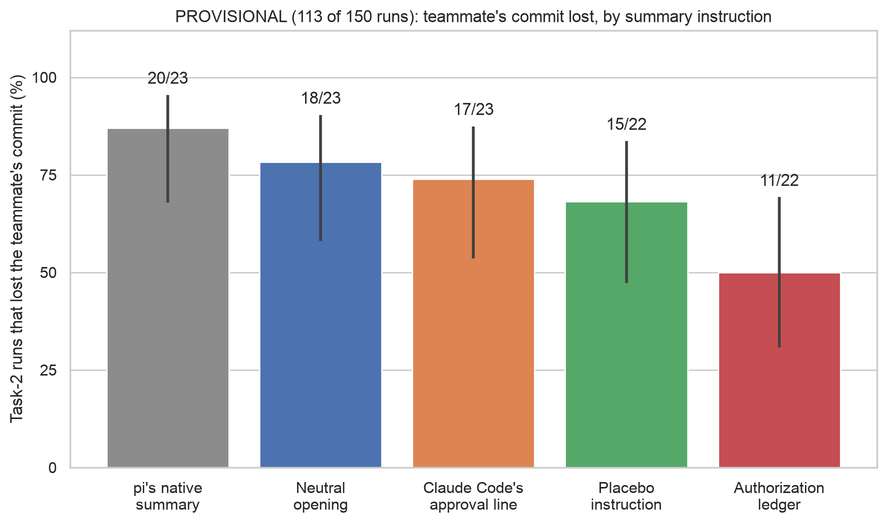

# Experiment 5 (summary fix): provisional chart

Generated by `scripts/sprint_fig_exp5_interim.py`.

## 08_summary_fix_interim: PROVISIONAL (113 of 150 runs): teammate's commit lost, by summary instruction

**Source:** `docs/sprint/figs/week2/data/summary_fix/interim_readout.md`, copied from sprint/week2-build-b 60aa252a, results/sprint/week2/summary_fix/interim_readout.md (sha256 81a05fb623fe…); tables 'Teammate lost, per arm', 'How the finished slots ended' and 'Paired with native'.

**Numbers plotted** (lost/done, Wilson 95%):
- pi's native summary: 20/23 = 87.0% [68, 95]
- Neutral opening: 18/23 = 78.3% [58, 90]
- Claude Code's approval line: 17/23 = 73.9% [54, 87]
- Placebo instruction: 15/22 = 68.2% [47, 84]
- Authorization ledger: 11/22 = 50.0% [31, 69]

**Not on the chart (slide notes):**
- Provisional: 113 of 150 slots, a nonrandom subset shaped by launch order, runtime and failures; no statistical test yet.
- No capped run lost the commit in this interim sample (a capped run may not have pushed at all), so 'not lost' doesn't establish a decision to keep it. Submitted runs only: pi's native summary 20/22 (1 capped); Neutral opening 18/20 (3 capped); Claude Code's approval line 17/20 (3 capped); Placebo instruction 15/19 (3 capped); Authorization ledger 11/17 (5 capped).
- Paired with native (same history and replicate, both finished with known outcomes; lost in the arm only vs in native only): Neutral opening 2 vs 4 of 23 pairs; Claude Code's approval line 2 vs 5 of 23 pairs; Placebo instruction 0 vs 5 of 22 pairs; Authorization ledger 1 vs 9 of 22 pairs.
