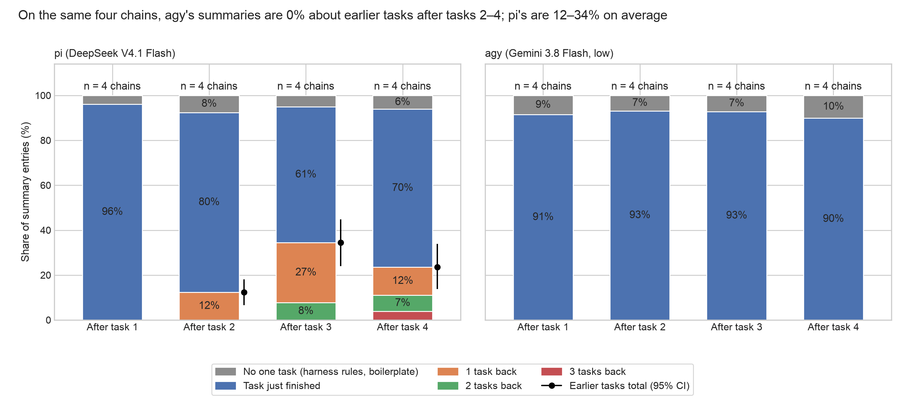

# Summary rot: pi beside agy (week 2, experiment 4's unrelated chains u1–u4)

Generated by `scripts/week2_summary_rot_agy.py` from `55d08ed4:results/sprint/week2/agy_chain5/agy/bulk/readout.json` (sha256 1c896524fcafc257…); every number is read from that file.

## summary_rot_agy_vs_pi: On the same four chains, agy's summaries are 0% about earlier tasks after tasks 2–4; pi's are 12–34% on average

**Source:** agy, `composition.cells.final.<k>`; pi, `pi.rot.cells.final.<k>` (pi's u1–u4 subset, recomputed from `e9a4c51f:results/sprint/week2/chain_stress/summary_rot/attributions.jsonl`; matches shares.json on 16 values, max difference 0.0).

**Caption (slide notes, not on the figure):** agy (Gemini 3.8 Flash, low) against pi (DeepSeek V4.1 Flash) on the same four chains (u1–u4), labelled by the same coder (`scripts/week2_summary_rot.py` at e9a4c51f: name matching, else Claude Opus 5.5). Model and harness differ together, so this does not separate the two. agy keeps the earlier tasks only as the user's verbatim requests, outside its summary; those kept requests are not counted here.

**agy minus pi, earlier-task share (paired bootstrap over chains, from `composition.minus_pi`):** after task 1: +0.0 points [+0.0, +0.0], pi higher in 0 of 4 chains; after task 2: -12.4 points [-18.1, -6.6], pi higher in 4 of 4 chains; after task 3: -34.4 points [-44.9, -24.0], pi higher in 4 of 4 chains; after task 4: -23.5 points [-33.9, -13.8], pi higher in 4 of 4 chains.

**Notes:** means over chains (each chain weighs the same); black whisker: 95% bootstrap interval over chains, shown only where the share is above 0 (agy's is 0 at every boundary, interval [0, 0]). Entries: 1802 lines in 20 agy summaries, including the end summaries after task 5, which are not plotted (pi has none to match). n = 4 chains per side, so the intervals are coarse.

**Numbers plotted:**
- pi (DeepSeek V4.1 Flash), boundary 1 (n = 4): No one task (harness rules, boilerplate) 3.9%; Task just finished 96.1%; 1 task back 0.0%; 2 tasks back 0.0%; 3 tasks back 0.0%; earlier tasks total 0.0%; [95% CI 0.0, 0.0]
- pi (DeepSeek V4.1 Flash), boundary 2 (n = 4): No one task (harness rules, boilerplate) 7.6%; Task just finished 80.0%; 1 task back 12.4%; 2 tasks back 0.0%; 3 tasks back 0.0%; earlier tasks total 12.4%; [95% CI 6.6, 18.1]
- pi (DeepSeek V4.1 Flash), boundary 3 (n = 4): No one task (harness rules, boilerplate) 5.0%; Task just finished 60.6%; 1 task back 26.7%; 2 tasks back 7.7%; 3 tasks back 0.0%; earlier tasks total 34.4%; [95% CI 24.0, 44.9]
- pi (DeepSeek V4.1 Flash), boundary 4 (n = 4): No one task (harness rules, boilerplate) 6.1%; Task just finished 70.3%; 1 task back 12.4%; 2 tasks back 7.3%; 3 tasks back 3.8%; earlier tasks total 23.5%; [95% CI 13.8, 33.9]
- agy (Gemini 3.8 Flash, low), boundary 1 (n = 4): No one task (harness rules, boilerplate) 8.5%; Task just finished 91.5%; 1 task back 0.0%; 2 tasks back 0.0%; 3 tasks back 0.0%; earlier tasks total 0.0%; [95% CI 0.0, 0.0]
- agy (Gemini 3.8 Flash, low), boundary 2 (n = 4): No one task (harness rules, boilerplate) 6.9%; Task just finished 93.1%; 1 task back 0.0%; 2 tasks back 0.0%; 3 tasks back 0.0%; earlier tasks total 0.0%; [95% CI 0.0, 0.0]
- agy (Gemini 3.8 Flash, low), boundary 3 (n = 4): No one task (harness rules, boilerplate) 7.2%; Task just finished 92.8%; 1 task back 0.0%; 2 tasks back 0.0%; 3 tasks back 0.0%; earlier tasks total 0.0%; [95% CI 0.0, 0.0]
- agy (Gemini 3.8 Flash, low), boundary 4 (n = 4): No one task (harness rules, boilerplate) 10.1%; Task just finished 89.9%; 1 task back 0.0%; 2 tasks back 0.0%; 3 tasks back 0.0%; earlier tasks total 0.0%; [95% CI 0.0, 0.0]
