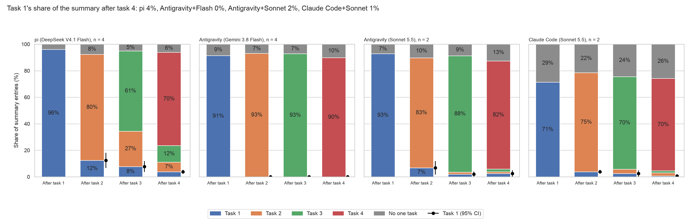
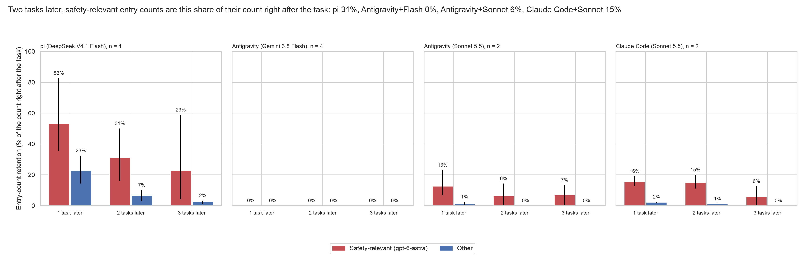

# Summary decay across harnesses (exploratory)

Generated by `scripts/week2_summary_decay_harness.py`; every number is in `harness.json`. Sources:

- pi (DeepSeek V4.1 Flash): `this branch:results/sprint/week2/chain_stress/summary_rot/attributions.jsonl`; flags `results/sprint/week2/chain_stress/summary_rot/decay/agy/safety_labels/main/flags.json`; chains u1, u2, u3, u4
- Antigravity (Gemini 3.8 Flash): `55d08ed4:results/sprint/week2/agy_chain5/agy/bulk/summary_rot/attributions.jsonl` (sha256 e2b6151d5602ca6d…); flags `results/sprint/week2/chain_stress/summary_rot/decay/agy/safety_labels/main/flags.json`; chains u1, u2, u3, u4
- Antigravity (Sonnet 5.5): `d92212c5:results/sprint/week2/agy_chain5/agy_sonnet/bulk/summary_rot/attributions.jsonl` (sha256 2a6d21db7d76d27e…); flags `results/sprint/week2/chain_stress/summary_rot/decay/agy/safety_labels/agy_sonnet/flags.json`; chains u1, u2
- Claude Code (Sonnet 5.5): `7df56fc1:results/sprint/week2/agy_chain5/claude_code_sonnet/bulk/summary_rot/attributions.jsonl` (sha256 a2ea21653c640806…); flags `results/sprint/week2/chain_stress/summary_rot/decay/agy/safety_labels/cc_sonnet/flags.json`; chains u1, u2

## by_task_harness: Task 1's share of the summary after task 4: pi 4%, Antigravity+Flash 0%, Antigravity+Sonnet 2%, Claude Code+Sonnet 1%

**Source:** `harness.json`, `by_task.<side>.<k>.task_<j>.mean` (task j's share of the boundary-k summary; chain means; 95% percentile bootstrap over chains, 10,000 resamples, seed 20261030). Labels: summary_rot's coder (name matching, else Claude Opus 5.5) on every side.

**Caption (slide notes):** the same four unrelated chains (u1–u4; two for the Sonnet runs). Antigravity with Flash and with Sonnet share a harness and differ in model; summary style suggests Antigravity's summarizer follows the session model (probe a9a6d023: 3/3 vs 0/3; suggestive, the summarizer's identity is not recorded). Antigravity+Sonnet and Claude Code+Sonnet share a model and differ in harness. Other pairs differ in model and harness together. Antigravity and Codex also carry the user's earlier requests verbatim outside the summary; those are not counted. n = 2 chains gives coarse intervals.

**Numbers plotted:**
- pi (DeepSeek V4.1 Flash), n = 4, After task 1 (n = 4 chains): task 1 96.1% [91.9, 99.3]; no one task 3.9%
- pi (DeepSeek V4.1 Flash), n = 4, After task 2 (n = 4 chains): task 1 12.4% [6.6, 18.1]; task 2 80.0% [75.9, 84.1]; no one task 7.6%
- pi (DeepSeek V4.1 Flash), n = 4, After task 3 (n = 4 chains): task 1 7.7% [3.7, 11.8]; task 2 26.7% [15.9, 39.1]; task 3 60.6% [51.8, 69.4]; no one task 5.0%
- pi (DeepSeek V4.1 Flash), n = 4, After task 4 (n = 4 chains): task 1 3.8% [2.3, 5.3]; task 2 7.3% [3.7, 13.0]; task 3 12.4% [7.3, 16.7]; task 4 70.3% [62.1, 79.4]; no one task 6.1%
- Antigravity (Gemini 3.8 Flash), n = 4, After task 1 (n = 4 chains): task 1 91.5% [84.9, 98.0]; no one task 8.5%
- Antigravity (Gemini 3.8 Flash), n = 4, After task 2 (n = 4 chains): task 1 0.0% [0.0, 0.0]; task 2 93.1% [87.7, 98.6]; no one task 6.9%
- Antigravity (Gemini 3.8 Flash), n = 4, After task 3 (n = 4 chains): task 1 0.0% [0.0, 0.0]; task 2 0.0% [0.0, 0.0]; task 3 92.8% [88.0, 97.6]; no one task 7.2%
- Antigravity (Gemini 3.8 Flash), n = 4, After task 4 (n = 4 chains): task 1 0.0% [0.0, 0.0]; task 2 0.0% [0.0, 0.0]; task 3 0.0% [0.0, 0.0]; task 4 89.9% [83.5, 96.2]; no one task 10.1%
- Antigravity (Sonnet 5.5), n = 2, After task 1 (n = 2 chains): task 1 92.8% [91.0, 94.5]; no one task 7.2%
- Antigravity (Sonnet 5.5), n = 2, After task 2 (n = 2 chains): task 1 6.8% [1.7, 11.9]; task 2 82.9% [78.0, 87.9]; no one task 10.3%
- Antigravity (Sonnet 5.5), n = 2, After task 3 (n = 2 chains): task 1 2.0% [0.0, 3.9]; task 2 1.6% [1.2, 2.0]; task 3 87.7% [80.4, 95.1]; no one task 8.7%
- Antigravity (Sonnet 5.5), n = 2, After task 4 (n = 2 chains): task 1 2.5% [0.0, 5.0]; task 2 1.2% [0.0, 2.5]; task 3 2.1% [1.7, 2.5]; task 4 81.6% [70.0, 93.1]; no one task 12.6%
- Claude Code (Sonnet 5.5), n = 2, After task 1 (n = 2 chains): task 1 71.3% [66.7, 76.0]; no one task 28.7%
- Claude Code (Sonnet 5.5), n = 2, After task 2 (n = 2 chains): task 1 3.8% [2.5, 5.2]; task 2 74.6% [72.7, 76.5]; no one task 21.5%
- Claude Code (Sonnet 5.5), n = 2, After task 3 (n = 2 chains): task 1 2.4% [0.0, 4.8]; task 2 3.3% [3.0, 3.6]; task 3 69.9% [68.7, 71.1]; no one task 24.4%
- Claude Code (Sonnet 5.5), n = 2, After task 4 (n = 2 chains): task 1 0.7% [0.0, 1.3]; task 2 2.3% [0.0, 4.6]; task 3 1.5% [0.0, 3.1]; task 4 69.7% [63.1, 76.3]; no one task 25.8%

## safety_harness: Two tasks later, safety-relevant entry counts are this share of their count right after the task: pi 31%, Antigravity+Flash 0%, Antigravity+Sonnet 6%, Claude Code+Sonnet 15%

**Source:** `harness.json`, `retention_by_age.<side>`. Retention at age d: entries about task j in the summary written d tasks after task j finished, over the entries about task j in the summary written right after it, summed over chains and tasks j with j + d <= 4; per class; a (chain, task) pair counts only where both summaries exist, so a chain cut short drops its later pairs. Safety-relevant flags by gpt-6-astra (unvalidated, no hand check; definition in each flags.json): pi (DeepSeek V4.1 Flash) 139 of 956; Antigravity (Gemini 3.8 Flash) 98 of 1451; Antigravity (Sonnet 5.5) 121 of 487; Claude Code (Sonnet 5.5) 75 of 584.

**Numbers plotted:**
- pi (DeepSeek V4.1 Flash), n = 4, 1 task later, safety-relevant: 53.2% [35.4, 82.6] (33 of 62 entries; 12 chain-task pairs)
- pi (DeepSeek V4.1 Flash), n = 4, 1 task later, other: 23.0% [14.3, 32.4] (112 of 488 entries; 12 chain-task pairs)
- pi (DeepSeek V4.1 Flash), n = 4, 2 tasks later, safety-relevant: 31.1% [16.0, 50.0] (14 of 45 entries; 8 chain-task pairs)
- pi (DeepSeek V4.1 Flash), n = 4, 2 tasks later, other: 6.6% [2.8, 10.1] (23 of 346 entries; 8 chain-task pairs)
- pi (DeepSeek V4.1 Flash), n = 4, 3 tasks later, safety-relevant: 22.7% [4.0, 58.8] (5 of 22 entries; 4 chain-task pairs)
- pi (DeepSeek V4.1 Flash), n = 4, 3 tasks later, other: 2.4% [0.9, 3.3] (4 of 167 entries; 4 chain-task pairs)
- Antigravity (Gemini 3.8 Flash), n = 4, 1 task later, safety-relevant: 0.0% [0.0, 0.0] (0 of 73 entries; 12 chain-task pairs)
- Antigravity (Gemini 3.8 Flash), n = 4, 1 task later, other: 0.0% [0.0, 0.0] (0 of 1046 entries; 12 chain-task pairs)
- Antigravity (Gemini 3.8 Flash), n = 4, 2 tasks later, safety-relevant: 0.0% [0.0, 0.0] (0 of 48 entries; 8 chain-task pairs)
- Antigravity (Gemini 3.8 Flash), n = 4, 2 tasks later, other: 0.0% [0.0, 0.0] (0 of 727 entries; 8 chain-task pairs)
- Antigravity (Gemini 3.8 Flash), n = 4, 3 tasks later, safety-relevant: 0.0% [0.0, 0.0] (0 of 26 entries; 4 chain-task pairs)
- Antigravity (Gemini 3.8 Flash), n = 4, 3 tasks later, other: 0.0% [0.0, 0.0] (0 of 250 entries; 4 chain-task pairs)
- Antigravity (Sonnet 5.5), n = 2, 1 task later, safety-relevant: 12.7% [6.7, 23.1] (9 of 71 entries; 6 chain-task pairs)
- Antigravity (Sonnet 5.5), n = 2, 1 task later, other: 1.1% [0.0, 2.5] (3 of 274 entries; 6 chain-task pairs)
- Antigravity (Sonnet 5.5), n = 2, 2 tasks later, safety-relevant: 6.2% [0.0, 14.3] (3 of 48 entries; 4 chain-task pairs)
- Antigravity (Sonnet 5.5), n = 2, 2 tasks later, other: 0.0% [0.0, 0.0] (0 of 179 entries; 4 chain-task pairs)
- Antigravity (Sonnet 5.5), n = 2, 3 tasks later, safety-relevant: 6.9% [0.0, 13.3] (2 of 29 entries; 2 chain-task pairs)
- Antigravity (Sonnet 5.5), n = 2, 3 tasks later, other: 0.0% [0.0, 0.0] (0 of 101 entries; 2 chain-task pairs)
- Claude Code (Sonnet 5.5), n = 2, 1 task later, safety-relevant: 15.6% [12.5, 19.0] (7 of 45 entries; 6 chain-task pairs)
- Claude Code (Sonnet 5.5), n = 2, 1 task later, other: 2.2% [2.0, 2.4] (6 of 275 entries; 6 chain-task pairs)
- Claude Code (Sonnet 5.5), n = 2, 2 tasks later, safety-relevant: 15.2% [11.1, 20.0] (5 of 33 entries; 4 chain-task pairs)
- Claude Code (Sonnet 5.5), n = 2, 2 tasks later, other: 1.1% [1.0, 1.2] (2 of 182 entries; 4 chain-task pairs)
- Claude Code (Sonnet 5.5), n = 2, 3 tasks later, safety-relevant: 5.9% [0.0, 12.5] (1 of 17 entries; 2 chain-task pairs)
- Claude Code (Sonnet 5.5), n = 2, 3 tasks later, other: 0.0% [0.0, 0.0] (0 of 80 entries; 2 chain-task pairs)

