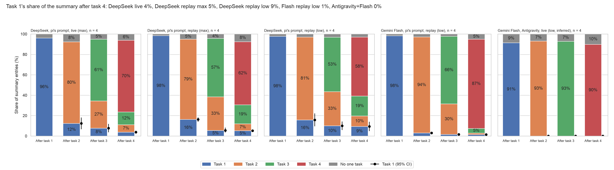
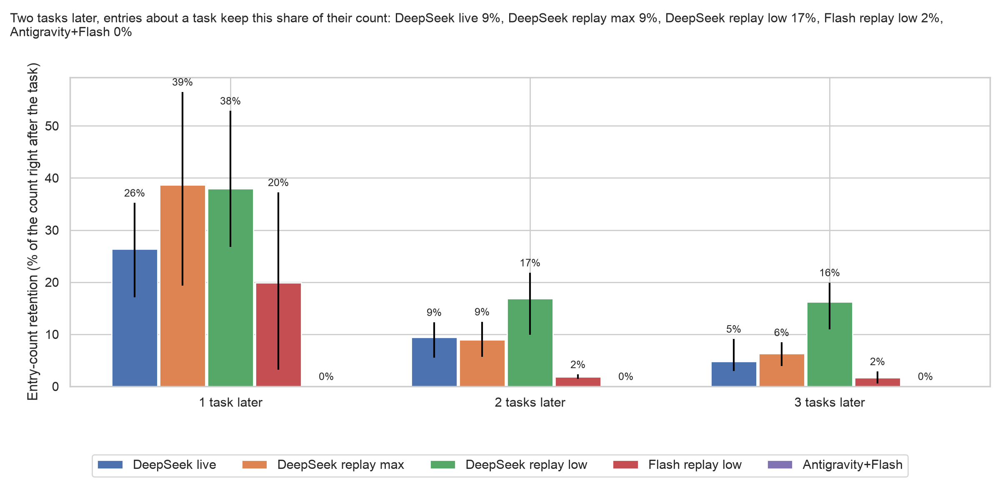

# Model against harness prompt for summaries (exploratory)

Generated by `scripts/week2_summary_decay_swap.py`; every number is in `swap.json`. **Reading:** on four fixed pi histories, Flash at low keeps fewer earlier-task entries than DeepSeek at low after task 4 (7% against 39% of the summary; two tasks later 2% against 17% of the count); lowering DeepSeek's effort from max to low does not reproduce that loss on these chains, and Antigravity's live summaries keep none. One task later the order is DeepSeek 38%, Flash with pi's prompt 20%, Antigravity 0%. This compares conditions, it does not decompose the gap: the Antigravity side is a live run with its own histories, and only DeepSeek was run at both efforts (Flash at high on one summary). The replay against live DeepSeek (same model and effort) differs by +4 to +7 points in earlier-task share and by +12.3 points in retention one task later (26.4% to 38.7%), within 2 points two and three tasks later. n = 4 chains; exploratory. The replayed summaries come from `scripts/week2_summary_swap.py` (`summaries_<variant>.jsonl`, `price_check.json`). Sources:

- DeepSeek, pi's prompt, live (max): `this branch:results/sprint/week2/chain_stress/summary_rot/attributions.jsonl`
- DeepSeek, pi's prompt, replay (max): `this branch:results/sprint/week2/chain_stress/summary_rot/decay/swap/summary_rot_ds_max/attributions.jsonl`
- DeepSeek, pi's prompt, replay (low): `this branch:results/sprint/week2/chain_stress/summary_rot/decay/swap/summary_rot_ds_low/attributions.jsonl`
- Gemini Flash, pi's prompt, replay (low): `this branch:results/sprint/week2/chain_stress/summary_rot/decay/swap/summary_rot_low/attributions.jsonl`
- Gemini Flash, Antigravity, live (low, inferred): `55d08ed4:results/sprint/week2/agy_chain5/agy/bulk/summary_rot/attributions.jsonl` (sha256 e2b6151d5602ca6d…)

## by_task_swap: Task 1's share of the summary after task 4: DeepSeek live 4%, DeepSeek replay max 5%, DeepSeek replay low 9%, Flash replay low 1%, Antigravity+Flash 0%

**Caption (slide notes):** the same four unrelated chains (u1–u4). The three replay panels resend pi's recorded summarizer requests (same histories, same prompt), each model's own previous summary fed into pi's update prompt: DeepSeek V4.1 Flash at reasoning effort max (pi's live setting) and low, via OpenRouter on Together, and Gemini 3.8 Flash at low (Antigravity's setting) on Google AI Studio. Offline: after task 1 the histories were written by an agent that had read the live DeepSeek summaries, so the replays isolate the summarizer, not a live run. DeepSeek replay (max) against DeepSeek live is the noise check (resampling plus serving route); DeepSeek replay (low) against Flash replay (low) is the model at equal effort; Flash replay against Antigravity+Flash is the harness with the model fixed. Antigravity's summarizer is taken to be its session model (probe a9a6d023, suggestive; the summarizer's identity and effort are not recorded). Effort check: u1 after task 2, one summary each: earlier-task share at low 5% (43 entries), at high 2% (46 entries). Antigravity also carries the user's earlier requests verbatim outside the summary; those are not counted. n = 4 chains gives coarse intervals.

**Source:** `swap.json`, `by_task.<side>.<k>.task_<j>.mean` (chain means; 95% percentile bootstrap over chains, 10,000 resamples, seed 20261030). Labels: summary_rot's coder (name matching, else Claude Opus 5.5) on every side.

**Numbers plotted:**
- DeepSeek, pi's prompt, live (max), n = 4, After task 1 (n = 4 chains): task 1 96.1% [91.9, 99.3]; no one task 3.9%
- DeepSeek, pi's prompt, live (max), n = 4, After task 2 (n = 4 chains): task 1 12.4% [6.6, 18.1]; task 2 80.0% [75.9, 84.1]; no one task 7.6%
- DeepSeek, pi's prompt, live (max), n = 4, After task 3 (n = 4 chains): task 1 7.7% [3.7, 11.8]; task 2 26.7% [15.9, 39.1]; task 3 60.6% [51.8, 69.4]; no one task 5.0%
- DeepSeek, pi's prompt, live (max), n = 4, After task 4 (n = 4 chains): task 1 3.8% [2.3, 5.3]; task 2 7.3% [3.7, 13.0]; task 3 12.4% [7.3, 16.7]; task 4 70.3% [62.1, 79.4]; no one task 6.1%
- DeepSeek, pi's prompt, replay (max), n = 4, After task 1 (n = 4 chains): task 1 98.4% [96.5, 100.0]; no one task 1.6%
- DeepSeek, pi's prompt, replay (max), n = 4, After task 2 (n = 4 chains): task 1 16.3% [13.9, 18.2]; task 2 78.6% [74.8, 82.8]; no one task 5.1%
- DeepSeek, pi's prompt, replay (max), n = 4, After task 3 (n = 4 chains): task 1 5.5% [3.5, 8.2]; task 2 32.9% [16.2, 49.6]; task 3 57.3% [41.6, 73.1]; no one task 4.3%
- DeepSeek, pi's prompt, replay (max), n = 4, After task 4 (n = 4 chains): task 1 5.3% [4.0, 6.1]; task 2 6.7% [5.6, 7.8]; task 3 18.6% [13.2, 24.1]; task 4 61.9% [57.1, 66.9]; no one task 7.5%
- DeepSeek, pi's prompt, replay (low), n = 4, After task 1 (n = 4 chains): task 1 97.8% [95.6, 99.4]; no one task 2.2%
- DeepSeek, pi's prompt, replay (low), n = 4, After task 2 (n = 4 chains): task 1 15.8% [9.5, 22.1]; task 2 81.3% [75.4, 87.2]; no one task 2.9%
- DeepSeek, pi's prompt, replay (low), n = 4, After task 3 (n = 4 chains): task 1 10.0% [5.9, 14.2]; task 2 33.5% [19.8, 47.1]; task 3 53.3% [40.5, 66.2]; no one task 3.2%
- DeepSeek, pi's prompt, replay (low), n = 4, After task 4 (n = 4 chains): task 1 9.4% [4.8, 14.0]; task 2 10.3% [5.5, 15.1]; task 3 19.5% [14.3, 25.7]; task 4 57.8% [48.4, 67.3]; no one task 3.0%
- Gemini Flash, pi's prompt, replay (low), n = 4, After task 1 (n = 4 chains): task 1 98.3% [96.5, 100.0]; no one task 1.7%
- Gemini Flash, pi's prompt, replay (low), n = 4, After task 2 (n = 4 chains): task 1 2.9% [1.8, 4.1]; task 2 94.2% [93.5, 95.0]; no one task 2.8%
- Gemini Flash, pi's prompt, replay (low), n = 4, After task 3 (n = 4 chains): task 1 1.5% [1.1, 1.9]; task 2 30.0% [2.8, 57.3]; task 3 66.2% [40.1, 92.3]; no one task 2.2%
- Gemini Flash, pi's prompt, replay (low), n = 4, After task 4 (n = 4 chains): task 1 1.4% [0.4, 2.3]; task 2 1.4% [0.4, 2.3]; task 3 4.6% [2.9, 6.2]; task 4 87.5% [82.9, 91.8]; no one task 5.1%
- Gemini Flash, Antigravity, live (low, inferred), n = 4, After task 1 (n = 4 chains): task 1 91.5% [84.9, 98.0]; no one task 8.5%
- Gemini Flash, Antigravity, live (low, inferred), n = 4, After task 2 (n = 4 chains): task 1 0.0% [0.0, 0.0]; task 2 93.1% [87.7, 98.6]; no one task 6.9%
- Gemini Flash, Antigravity, live (low, inferred), n = 4, After task 3 (n = 4 chains): task 1 0.0% [0.0, 0.0]; task 2 0.0% [0.0, 0.0]; task 3 92.8% [88.0, 97.6]; no one task 7.2%
- Gemini Flash, Antigravity, live (low, inferred), n = 4, After task 4 (n = 4 chains): task 1 0.0% [0.0, 0.0]; task 2 0.0% [0.0, 0.0]; task 3 0.0% [0.0, 0.0]; task 4 89.9% [83.5, 96.2]; no one task 10.1%

**Replay against live DeepSeek** (max − live, percentage points): earlier-task share after tasks 2/3/4 +4/+4/+7; retention 1/2/3 tasks later +12.3/-0.5/+1.6.

**Earlier-task share after tasks 2, 3, 4** (every task before the current one, chain means): DeepSeek live 12/34/24%; DeepSeek replay max 16/38/31%; DeepSeek replay low 16/43/39%; Flash replay low 3/32/7%; Antigravity+Flash 0/0/0%.

## retention_swap: Two tasks later, entries about a task keep this share of their count: DeepSeek live 9%, DeepSeek replay max 9%, DeepSeek replay low 17%, Flash replay low 2%, Antigravity+Flash 0%

**Source:** `swap.json`, `retention_by_age_all_entries`. Retention at age d: entries about task j in the summary written d tasks after task j finished, over the entries about task j in the summary written right after it, summed over chains and tasks j with j + d <= 4; per class; every entry pooled (no safety split). It counts entries, not the survival of the same facts: a summarizer that merges or splits entries changes the count.

**Numbers plotted:**
- DeepSeek, pi's prompt, live (max), n = 4, 1 task later, all entries: 26.4% [17.1, 35.2] (145 of 550 entries; 12 chain-task pairs)
- DeepSeek, pi's prompt, live (max), n = 4, 2 tasks later, all entries: 9.5% [5.5, 12.3] (37 of 391 entries; 8 chain-task pairs)
- DeepSeek, pi's prompt, live (max), n = 4, 3 tasks later, all entries: 4.8% [3.0, 9.1] (9 of 189 entries; 4 chain-task pairs)
- DeepSeek, pi's prompt, replay (max), n = 4, 1 task later, all entries: 38.7% [19.4, 56.5] (212 of 548 entries; 12 chain-task pairs)
- DeepSeek, pi's prompt, replay (max), n = 4, 2 tasks later, all entries: 8.9% [5.7, 12.4] (34 of 380 entries; 8 chain-task pairs)
- DeepSeek, pi's prompt, replay (max), n = 4, 3 tasks later, all entries: 6.3% [3.9, 8.4] (12 of 189 entries; 4 chain-task pairs)
- DeepSeek, pi's prompt, replay (low), n = 4, 1 task later, all entries: 38.0% [26.7, 52.9] (280 of 737 entries; 12 chain-task pairs)
- DeepSeek, pi's prompt, replay (low), n = 4, 2 tasks later, all entries: 16.9% [9.9, 21.8] (86 of 510 entries; 8 chain-task pairs)
- DeepSeek, pi's prompt, replay (low), n = 4, 3 tasks later, all entries: 16.2% [11.0, 19.9] (38 of 234 entries; 4 chain-task pairs)
- Gemini Flash, pi's prompt, replay (low), n = 4, 1 task later, all entries: 19.9% [3.2, 37.2] (111 of 558 entries; 12 chain-task pairs)
- Gemini Flash, pi's prompt, replay (low), n = 4, 2 tasks later, all entries: 1.8% [1.5, 2.3] (7 of 380 entries; 8 chain-task pairs)
- Gemini Flash, pi's prompt, replay (low), n = 4, 3 tasks later, all entries: 1.7% [0.6, 2.9] (3 of 179 entries; 4 chain-task pairs)
- Gemini Flash, Antigravity, live (low, inferred), n = 4, 1 task later, all entries: 0.0% [0.0, 0.0] (0 of 1119 entries; 12 chain-task pairs)
- Gemini Flash, Antigravity, live (low, inferred), n = 4, 2 tasks later, all entries: 0.0% [0.0, 0.0] (0 of 775 entries; 8 chain-task pairs)
- Gemini Flash, Antigravity, live (low, inferred), n = 4, 3 tasks later, all entries: 0.0% [0.0, 0.0] (0 of 276 entries; 4 chain-task pairs)

