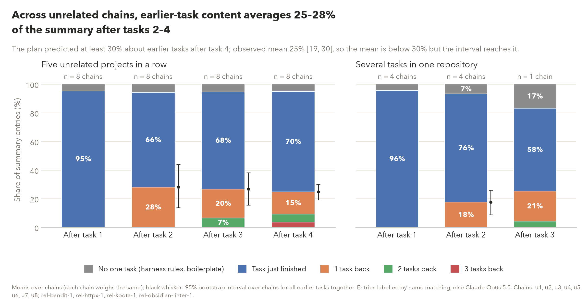
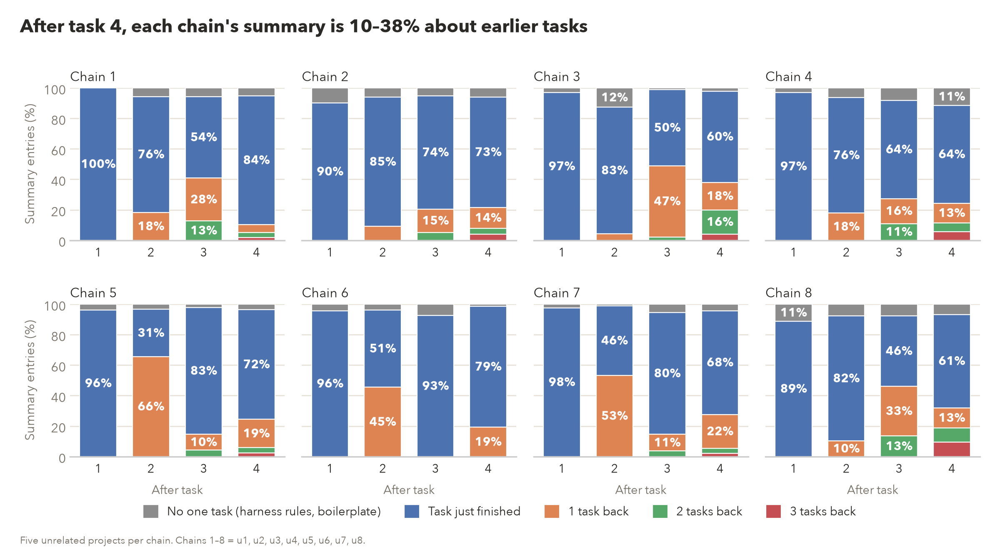

# Summary rot (week 2, experiment 4: five-task chains)

Generated by `scripts/week2_summary_rot.py figure` from `results/sprint/week2/chain_stress/summary_rot/shares.json` only; every number is read from that file.

## summary_rot: Across unrelated chains, earlier-task content averages 25–28% of the summary after tasks 2–4

**Source:** `results/sprint/week2/chain_stress/summary_rot/shares.json`, fields `cells.unrelated.boundary.<k>` and `cells.related.boundary.<k>` (`back_3`, `back_2`, `back_1`, `current`, `generic`, `earlier`, `earlier_ci95`, `n_chains`); the subtitle from `prediction`.

**Numbers plotted:**
- Five unrelated projects in a row, boundary 1 (n = 8): No one task (harness rules, boilerplate) 4.7%; Task just finished 95.3%; 1 task back 0.0%; 2 tasks back 0.0%; 3 tasks back 0.0%; earlier tasks total 0.0%; [95% CI 0.0, 0.0]
- Five unrelated projects in a row, boundary 2 (n = 8): No one task (harness rules, boilerplate) 5.8%; Task just finished 66.2%; 1 task back 28.0%; 2 tasks back 0.0%; 3 tasks back 0.0%; earlier tasks total 28.0%; [95% CI 13.7, 43.8]
- Five unrelated projects in a row, boundary 3 (n = 8): No one task (harness rules, boilerplate) 5.3%; Task just finished 68.0%; 1 task back 20.1%; 2 tasks back 6.5%; 3 tasks back 0.0%; earlier tasks total 26.6%; [95% CI 15.5, 38.0]
- Five unrelated projects in a row, boundary 4 (n = 8): No one task (harness rules, boilerplate) 5.0%; Task just finished 70.3%; 1 task back 15.4%; 2 tasks back 5.6%; 3 tasks back 3.6%; earlier tasks total 24.7%; [95% CI 19.1, 30.0]
- Several tasks in one repository, boundary 1 (n = 4): No one task (harness rules, boilerplate) 4.4%; Task just finished 95.6%; 1 task back 0.0%; 2 tasks back 0.0%; 3 tasks back 0.0%; earlier tasks total 0.0%; [95% CI 0.0, 0.0]
- Several tasks in one repository, boundary 2 (n = 4): No one task (harness rules, boilerplate) 6.8%; Task just finished 75.7%; 1 task back 17.5%; 2 tasks back 0.0%; 3 tasks back 0.0%; earlier tasks total 17.5%; [95% CI 8.7, 26.0]
- Several tasks in one repository, boundary 3 (n = 1): No one task (harness rules, boilerplate) 16.9%; Task just finished 57.7%; 1 task back 21.1%; 2 tasks back 4.2%; 3 tasks back 0.0%; earlier tasks total 25.4%; one chain (the only four-task repository chain); interval unavailable

## summary_rot_by_chain: After task 4, each chain's summary is 10–38% about earlier tasks

**Source:** `results/sprint/week2/chain_stress/summary_rot/shares.json`, field `per_summary[]` (arm unrelated, kind boundary: `shares`).

**Numbers plotted:**
- chain 1 (u1), after task 1: No one task (harness rules, boilerplate) 0.0%; Task just finished 100.0%; 1 task back 0.0%; 2 tasks back 0.0%; 3 tasks back 0.0%; 33 entries
- chain 1 (u1), after task 2: No one task (harness rules, boilerplate) 5.6%; Task just finished 76.1%; 1 task back 18.3%; 2 tasks back 0.0%; 3 tasks back 0.0%; 71 entries
- chain 1 (u1), after task 3: No one task (harness rules, boilerplate) 5.6%; Task just finished 53.5%; 1 task back 28.2%; 2 tasks back 12.7%; 3 tasks back 0.0%; 71 entries
- chain 1 (u1), after task 4: No one task (harness rules, boilerplate) 5.2%; Task just finished 84.5%; 1 task back 5.2%; 2 tasks back 3.4%; 3 tasks back 1.7%; 58 entries
- chain 2 (u2), after task 1: No one task (harness rules, boilerplate) 9.8%; Task just finished 90.2%; 1 task back 0.0%; 2 tasks back 0.0%; 3 tasks back 0.0%; 61 entries
- chain 2 (u2), after task 2: No one task (harness rules, boilerplate) 6.1%; Task just finished 84.8%; 1 task back 9.1%; 2 tasks back 0.0%; 3 tasks back 0.0%; 66 entries
- chain 2 (u2), after task 3: No one task (harness rules, boilerplate) 5.1%; Task just finished 74.4%; 1 task back 15.4%; 2 tasks back 5.1%; 3 tasks back 0.0%; 39 entries
- chain 2 (u2), after task 4: No one task (harness rules, boilerplate) 5.9%; Task just finished 72.5%; 1 task back 13.7%; 2 tasks back 3.9%; 3 tasks back 3.9%; 51 entries
- chain 3 (u3), after task 1: No one task (harness rules, boilerplate) 2.9%; Task just finished 97.1%; 1 task back 0.0%; 2 tasks back 0.0%; 3 tasks back 0.0%; 70 entries
- chain 3 (u3), after task 2: No one task (harness rules, boilerplate) 12.5%; Task just finished 83.3%; 1 task back 4.2%; 2 tasks back 0.0%; 3 tasks back 0.0%; 24 entries
- chain 3 (u3), after task 3: No one task (harness rules, boilerplate) 1.1%; Task just finished 50.0%; 1 task back 46.7%; 2 tasks back 2.2%; 3 tasks back 0.0%; 90 entries
- chain 3 (u3), after task 4: No one task (harness rules, boilerplate) 2.0%; Task just finished 60.0%; 1 task back 18.0%; 2 tasks back 16.0%; 3 tasks back 4.0%; 50 entries
- chain 4 (u4), after task 1: No one task (harness rules, boilerplate) 2.9%; Task just finished 97.1%; 1 task back 0.0%; 2 tasks back 0.0%; 3 tasks back 0.0%; 34 entries
- chain 4 (u4), after task 2: No one task (harness rules, boilerplate) 6.3%; Task just finished 75.8%; 1 task back 17.9%; 2 tasks back 0.0%; 3 tasks back 0.0%; 95 entries
- chain 4 (u4), after task 3: No one task (harness rules, boilerplate) 8.2%; Task just finished 64.4%; 1 task back 16.4%; 2 tasks back 11.0%; 3 tasks back 0.0%; 73 entries
- chain 4 (u4), after task 4: No one task (harness rules, boilerplate) 11.4%; Task just finished 64.3%; 1 task back 12.9%; 2 tasks back 5.7%; 3 tasks back 5.7%; 70 entries
- chain 5 (u5), after task 1: No one task (harness rules, boilerplate) 3.8%; Task just finished 96.2%; 1 task back 0.0%; 2 tasks back 0.0%; 3 tasks back 0.0%; 78 entries
- chain 5 (u5), after task 2: No one task (harness rules, boilerplate) 3.3%; Task just finished 31.1%; 1 task back 65.6%; 2 tasks back 0.0%; 3 tasks back 0.0%; 90 entries
- chain 5 (u5), after task 3: No one task (harness rules, boilerplate) 2.1%; Task just finished 83.3%; 1 task back 10.4%; 2 tasks back 4.2%; 3 tasks back 0.0%; 48 entries
- chain 5 (u5), after task 4: No one task (harness rules, boilerplate) 3.5%; Task just finished 72.1%; 1 task back 18.6%; 2 tasks back 3.5%; 3 tasks back 2.3%; 86 entries
- chain 6 (u6), after task 1: No one task (harness rules, boilerplate) 4.3%; Task just finished 95.7%; 1 task back 0.0%; 2 tasks back 0.0%; 3 tasks back 0.0%; 70 entries
- chain 6 (u6), after task 2: No one task (harness rules, boilerplate) 3.8%; Task just finished 50.8%; 1 task back 45.5%; 2 tasks back 0.0%; 3 tasks back 0.0%; 132 entries
- chain 6 (u6), after task 3: No one task (harness rules, boilerplate) 7.4%; Task just finished 92.6%; 1 task back 0.0%; 2 tasks back 0.0%; 3 tasks back 0.0%; 27 entries
- chain 6 (u6), after task 4: No one task (harness rules, boilerplate) 1.3%; Task just finished 79.5%; 1 task back 19.2%; 2 tasks back 0.0%; 3 tasks back 0.0%; 78 entries
- chain 7 (u7), after task 1: No one task (harness rules, boilerplate) 2.4%; Task just finished 97.6%; 1 task back 0.0%; 2 tasks back 0.0%; 3 tasks back 0.0%; 83 entries
- chain 7 (u7), after task 2: No one task (harness rules, boilerplate) 1.1%; Task just finished 45.7%; 1 task back 53.3%; 2 tasks back 0.0%; 3 tasks back 0.0%; 92 entries
- chain 7 (u7), after task 3: No one task (harness rules, boilerplate) 5.5%; Task just finished 80.0%; 1 task back 10.9%; 2 tasks back 3.6%; 3 tasks back 0.0%; 55 entries
- chain 7 (u7), after task 4: No one task (harness rules, boilerplate) 4.3%; Task just finished 68.1%; 1 task back 22.3%; 2 tasks back 3.2%; 3 tasks back 2.1%; 94 entries
- chain 8 (u8), after task 1: No one task (harness rules, boilerplate) 11.1%; Task just finished 88.9%; 1 task back 0.0%; 2 tasks back 0.0%; 3 tasks back 0.0%; 63 entries
- chain 8 (u8), after task 2: No one task (harness rules, boilerplate) 7.7%; Task just finished 82.1%; 1 task back 10.3%; 2 tasks back 0.0%; 3 tasks back 0.0%; 78 entries
- chain 8 (u8), after task 3: No one task (harness rules, boilerplate) 7.7%; Task just finished 46.2%; 1 task back 32.7%; 2 tasks back 13.5%; 3 tasks back 0.0%; 52 entries
- chain 8 (u8), after task 4: No one task (harness rules, boilerplate) 6.7%; Task just finished 61.3%; 1 task back 13.3%; 2 tasks back 9.3%; 3 tasks back 9.3%; 75 entries

**Trend (unrelated arm, earlier-task share, paired bootstrap over the 8 chains):** after task 4 minus after task 2: -3.3 points [-20.5, +13.5]; after task 4 minus after task 3: -1.9 points [-12.8, +8.2]. The title claims a trend only if the task 4 minus task 2 interval excludes 0.

**Unit: lines, not just bullets.** The plan's denominator is summary bullets; here every non-empty line counts (bullets, numbered items, prose and continuation lines). Bullet-only sensitivity (entries starting with -, *, + or a number; `cells.<arm>.boundary.<k>.shares_bullets_only`), unrelated earlier-task share: after task 1 0.0%, after task 2 28.6%, after task 3 27.5%, after task 4 24.9%.

**Limitation: headings removed from Opus's context.** Headings and bold sub-headings are excluded as structure and were not shown to Opus, so a sub-bullet under a heading such as `**KCP-256 (complete):**` lost that parent. Of 545 excluded headings in boundary summaries, 31 name a task identifier and 16 name an earlier task's identifier (`excluded_headings` in shares.json). Earlier-task content may be undercounted where Opus labelled such sub-bullets generic or current.

**Limitation: Opus prompt wording.** The Opus prompt says the agent worked through "several unrelated coding tasks", including for the related arm, whose tasks share one repository. The related-arm labels were not rerun.

**Related arm, after task 3:** one chain (koota), the only four-task repository chain; not comparable to the four-chain bars and no interval.

**Notes:** an entry is one non-empty summary line (headings, separators and bold-only sub-headings excluded). Label: the one task whose ticket tag, repo, package, branch or task id the line names, else Claude Opus 5.5's call (Max plan). In the related arm the repository is shared, so only tags, branches and Opus decide. Code-Opus agreement on code-decided entries: 917/921. Share decided by Opus: 69.8%. Not hand-checked yet (30-card sample in hand_check_sample.jsonl).
